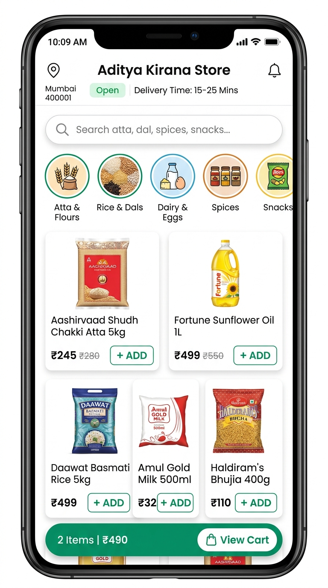
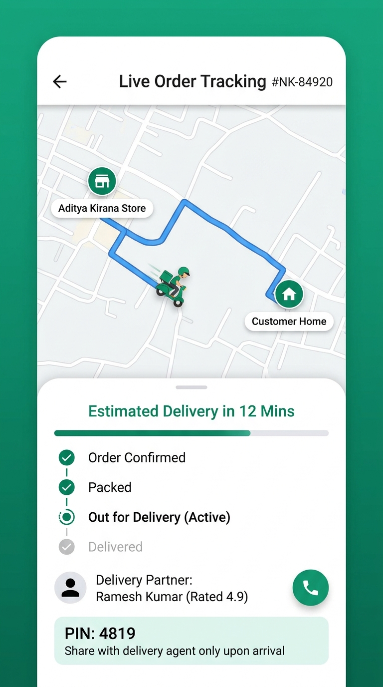
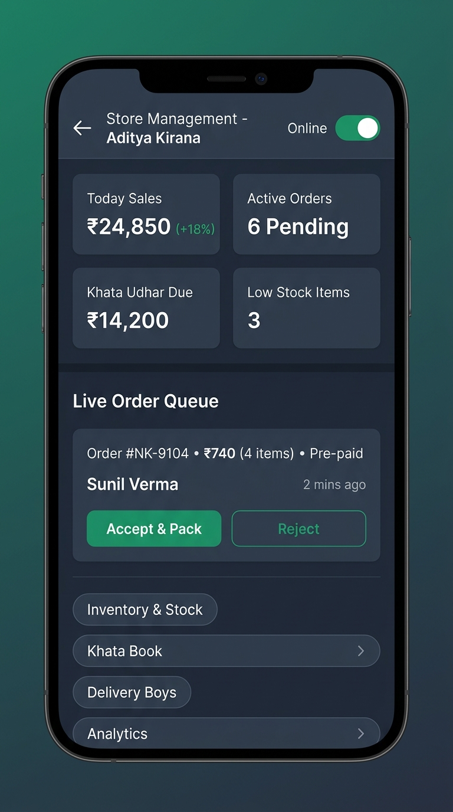
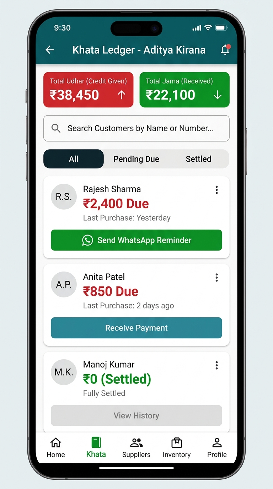

# NearKirana - Hyperlocal Kirana Delivery and Store ERP Platform

NearKirana is an enterprise-grade, multi-tenant Flutter application engineered to digitize traditional Indian neighborhood grocery stores (Kirana shops). The platform bridges local store owners, neighborhood customers, delivery agents, and platform administrators into a unified commerce ecosystem.

---

## Application Screenshots

| Customer Storefront | Live Delivery Tracking |
| :---: | :---: |
|  |  |
| **Storefront & Catalog**: Nearby shop selection, category carousels, stock-aware product grids, and persistent cart indicator. | **Real-Time GPS Tracking**: Road routing polyline, live driver position, dynamic ETA, and 4-digit delivery verification PIN. |

| Merchant Admin Dashboard | Digital Khata Ledger |
| :---: | :---: |
|  |  |
| **Merchant ERP Pipeline**: Live daily sales metrics, incoming order lifecycle management, and quick inventory shortcuts. | **Customer Credit Management**: Outstanding Udhar tracking, transaction history, and 1-click WhatsApp payment reminders. |

---

## System Overview and Core Concept

In traditional local retail, kirana stores face three primary operational hurdles:
1. Losing online grocery market share to quick-commerce dark stores.
2. Manual bookkeeping errors and delayed recovery of customer credit (Udhar/Khata).
3. Fragmented delivery management without route tracking or proof-of-delivery.

NearKirana resolves these challenges through a unified mobile and desktop platform:
- **For Customers**: Ultra-fast shopping from their trusted local kirana store, featuring instant delivery estimates, bilingual voice ordering, flexible payment options, and live map tracking.
- **For Store Owners (Merchants)**: A complete digital Point-of-Sale (POS) and Enterprise Resource Planning (ERP) suite with live order processing, batch expiry tracking, barcode inventory, supplier bookkeeping, and digital khata with automated WhatsApp reminders.
- **For Delivery Partners**: Dedicated order pick-up, turn-by-turn road navigation, customer calling, and secure 4-digit PIN verification upon handover.
- **For Super Admins**: Multi-shop governance, onboarding approval, KYC verification, and platform analytics.

---

## How the Application Works

### 1. Customer Shopping Flow

1. **Shop Selection and Location Discovery**:
   - The app uses GPS geofencing and device coordinates via `Geolocator` to locate registered kirana stores within a configurable delivery radius (typically 1 to 5 km).
   - Customers can also switch shops by entering a postal code or by scanning a store QR code generated by the merchant.

2. **Catalog Browsing and Smart Search**:
   - Products are organized into categories such as Flours & Grains, Pulses & Dals, Dairy & Eggs, Spices, and Edible Oils.
   - Substring keyword indexing (`searchKeywords`) in Cloud Firestore provides instant search suggestions.
   - Products display real-time stock levels, discounted MRP, unit measures (kg, g, litre, packet), and out-of-stock indicators.

3. **Intelligent Cart and Dynamic Pricing**:
   - Managed via `CartProvider` and `CartCalculator`.
   - Validates minimum order amounts set by the specific shop.
   - Calculates dynamic tiered delivery fees based on order value (e.g., Free delivery above Rs. 499).
   - Allows customers to redeem accumulated Loyalty Reward Points or apply promotional coupon codes.

4. **Address Management and Checkout**:
   - Customers select or add delivery addresses complete with flat details, landmark, and GPS pin on an interactive map (`flutter_map`).
   - Payment modes supported: Cash on Delivery (COD), UPI, and Razorpay online gateway integration.

5. **Live Order Tracking and Secure Handover**:
   - Once dispatched, customers track their order on a live road-following map powered by the Open Source Routing Machine (OSRM) and device GPS.
   - A unique 4-digit Delivery PIN is generated for each order. The customer provides this PIN to the delivery partner at the doorstep to conclude delivery.

6. **Voice Ordering (Bilingual NLP)**:
   - Built-in speech-to-text service (`voice_order_parser.dart` and `voice_order_service.dart`).
   - Customers can speak in Hindi or English (e.g., "Do kilo Aashirvaad aata aur ek packet namak").
   - A regex-driven parser identifies items, numeric quantities, and units, and maps them to catalog items for 1-click cart insertion.

7. **Smart Shopping Lists and Loyalty Program**:
   - Recurring household grocery items can be saved into custom shopping lists.
   - Points are earned on completed orders and can be redeemed for direct cash discounts on subsequent purchases.

---

### 2. Merchant and Store Owner (Admin) Flow

1. **Store Onboarding and Geofencing**:
   - Merchants register their store with shop name, owner contacts, GPS coordinates, operating hours, delivery radius, minimum order threshold, and default delivery fee structure.
   - Generates a custom printable UPI and Shop QR code for storefront display.

2. **Live Order Management State Machine**:
   - Incoming orders enter a strict lifecycle:
     - `Pending` -> `Accepted` -> `Packing` -> `Out for Delivery` -> `Delivered` (or `Cancelled`).
   - Store managers can suggest item substitutions if a requested brand is temporarily unavailable.
   - Orders can be assigned directly to in-house shop boys or affiliated delivery partners.

3. **Inventory, Barcode Scanning, and Expiry Management**:
   - Direct barcode scanning via mobile camera (`simple_barcode_scanner`) for instant product lookup or addition.
   - Batch numbers and expiry date tracking (`batch_service.dart`) alert merchants to approaching expiration dates, reducing stock wastage.
   - Low-stock threshold alerts indicate when items drop below a specified reserve quantity.

4. **Digital Khata (Customer Credit Ledger)**:
   - Digital replacement for paper bahi-khata.
   - Merchants track debit (Udhar given) and credit (Jama received) per customer.
   - Generates instant PDF account statements.
   - Integrated WhatsApp reminder trigger opens WhatsApp with a personalized payment summary link and outstanding dues.

5. **Supplier and Procurement Management**:
   - Directory of wholesale distributors and FMCG suppliers.
   - Records incoming inventory purchase invoices, payments made, and pending payables to vendors.

6. **Business Analytics and Tax Invoicing**:
   - Visual revenue breakdowns, gross merchandise value (GMV), order counts, and category performance charts via `fl_chart`.
   - Integrated PDF invoice generation engine (`printing` and `pdf` packages) to produce formatted tax receipts with shop branding.

---

### 3. Delivery Partner Workflow

1. **Duty Management**:
   - Delivery personnel toggle duty availability and view assigned orders.
2. **Order Pickup**:
   - Verification of packed order contents against the merchant bill.
3. **Turn-by-Turn Routing**:
   - Route polyline mapped from the store to customer location with real-time GPS coordinate synchronization.
4. **PIN Verification**:
   - Delivery cannot be finalized without inputting the customer's 4-digit PIN, eliminating fraudulent or misplaced deliveries.

---

### 4. Super Admin Governance

1. Multi-shop monitoring, status controls (Activate / Deactivate), and KYC validation.
2. Platform commission tracking and global dispute management.
3. System-wide catalog master templates to accelerate store onboarding.

---

## Technical Architecture

### Tech Stack

- **Framework**: Flutter 3.x (Dart 3.x SDK)
- **State Management**: Provider Pattern (`ChangeNotifierProvider`, `MultiProvider`)
- **Backend Database**: Google Cloud Firestore (NoSQL, Realtime document listeners)
- **Authentication**: Firebase Authentication, Phone/Email verification via InAppWebView
- **Mapping & GIS**: `flutter_map`, `latlong2`, Open Source Routing Machine (OSRM) road routing
- **Location Services**: `geolocator`, `geocoding`
- **Charts & Visualization**: `fl_chart`
- **Payment Processing**: Razorpay Flutter SDK, UPI deep-linking
- **Hardware Integration**: Camera barcode scanner, Vibration engine, Local audio alerts
- **Document Generation**: PDF generation and native thermal printing via `pdf` and `printing`
- **Voice Recognition**: `speech_to_text` with custom linguistic parser

---

### Firestore Database Schema

The platform utilizes a multi-tenant NoSQL structure in Cloud Firestore:

- `shops`: Store configuration, business hours, geofence radius, delivery fee settings, UPI QR IDs.
- `products`: Product catalog tied to `shopId`, categories, MRP, sale price, stock quantity, batch info, search keywords.
- `orders`: Order document containing customer details, item breakdown, price calculations, order status, assigned delivery partner, and delivery PIN.
- `users`: User profiles, role assignments (Customer, Admin, ShopBoy, SuperAdmin), saved delivery addresses, and loyalty point ledger.
- `khata`: Customer ledger entries with credit/debit transaction logs, timestamps, and payment proof references.
- `suppliers`: Supplier directory, procurement order records, and pending purchase balances.
- `coupons`: Active promotion codes, percentage/flat discounts, minimum cart values, and expiration rules.
- `complaints`: Customer feedback, resolution tickets, and refund requests.

---

## Project Directory Structure

```text
NearKirana/
├── android/                 # Android platform build configs
├── ios/                     # iOS platform build configs
├── web/                     # Web platform deployment assets
├── assets/
│   ├── images/              # Branding and vector assets
│   ├── lottie/              # Animated Lottie illustrations
│   └── sounds/              # Order alert notifications
├── docs/
│   └── screenshots/         # Application documentation screenshots
├── lib/
│   ├── l10n/                # Localization ARB files (English, Hindi, etc.)
│   ├── widgets/             # Reusable UI widgets and custom components
│   ├── admin_dashboard.dart # Merchant ERP control center
│   ├── admin_orders_tab.dart# Order processing pipeline
│   ├── atomic_order_service.dart # ACID-compliant Firestore order service
│   ├── cart_provider.dart   # Shopping cart state management
│   ├── cart_screen.dart     # Mobile and desktop checkout interface
│   ├── custom_auth_screen.dart # User verification flow
│   ├── customer_live_tracking_screen.dart # Real-time GPS delivery tracking
│   ├── customer_shop_tab.dart # Customer storefront and catalog browser
│   ├── khata_screen.dart    # Digital ledger bookkeeping
│   ├── main.dart            # Application entry point and router
│   ├── order_state_machine.dart # Order status progression engine
│   ├── road_routing_service.dart# Road polyline and ETA calculations
│   ├── shop_provider.dart   # Multi-shop selector and geofencing
│   ├── voice_order_parser.dart # Bilingual voice order parsing logic
│   └── ...
└── pubspec.yaml             # Dart dependencies and asset registrations
```

---

## Getting Started

### Prerequisites

- Flutter SDK (version 3.12.2 or higher)
- Dart SDK (version 3.x)
- Android Studio / Xcode for mobile emulator execution
- Firebase Project configured with Firestore, Auth, and Storage

### Installation

1. Clone the repository:
   ```bash
   git clone https://github.com/Balmukund-Maurya/NearKirana_Kirana_StoreBuilder.git
   ```

2. Change to the project directory:
   ```bash
   cd NearKirana_Kirana_StoreBuilder
   ```

3. Install project dependencies:
   ```bash
   flutter pub get
   ```

4. Generate localization files:
   ```bash
   flutter gen-l10n
   ```

5. Verify Flutter configuration and connected devices:
   ```bash
   flutter doctor
   flutter devices
   ```

6. Run the application:
   ```bash
   flutter run
   ```

---

## Security and Production Guidelines

- **Firebase Security Rules**: Ensure `firestore.rules` enforces tenant data isolation such that merchants can only read and write documents matching their verified `shopId`.
- **Delivery Verification**: The delivery PIN validation is verified atomically inside `atomic_order_service.dart` to prevent race conditions during order finalization.
- **Credential Storage**: Sensitive payment API keys (such as Razorpay Key ID and Secret) must be supplied via compile-time environment variables (`--dart-define`) rather than hardcoded in source control.

---

## License

This project is proprietary and developed for local kirana store digitization and hyperlocal grocery delivery networks.
