# 🛍️ NearKirana - Hyperlocal Kirana Delivery & Enterprise ERP Platform

<p align="center">
  
</p>

<p align="center">
  <strong>Next-Generation Multi-Tenant Quick-Commerce & Store Digitization Engine for Neighborhood Retail</strong>
</p>

<p align="center">
  
  
  
  
  
</p>

---

## 📑 Table of Contents

1. [Executive Summary & Problem Statement](#-executive-summary--problem-statement)
2. [Complete Visual Tour & Screenshot Gallery (23 Authentic Screens)](#-complete-visual-tour--screenshot-gallery-23-authentic-screens)
   - [Customer Onboarding & Role Architecture](#1-customer-onboarding--role-architecture)
   - [Hyperlocal Store Discovery & Catalog Browsing](#2-hyperlocal-store-discovery--catalog-browsing)
   - [Customer Ordering, PIN Verification & Smart Lists](#3-customer-ordering-pin-verification--smart-lists)
   - [Merchant Control Center & Fulfillment Pipeline](#4-merchant-control-center--fulfillment-pipeline)
   - [Store Inventory, Barcode Scanner & Batch Tracking](#5-store-inventory-barcode-scanner--batch-tracking)
   - [Digital Khata Ledger & Financial Recovery](#6-digital-khata-ledger--financial-recovery)
   - [Sales, COGS & Net Profit Analytics](#7-sales-cogs--net-profit-analytics)
   - [Delivery Fleet Operations & Doorstep PIN Verification](#8-delivery-fleet-operations--doorstep-pin-verification)
   - [Customer Support, Disputes & Loyalty Coins](#9-customer-support-disputes--loyalty-coins)
   - [Enterprise Governance, Staff Audit & CA Data Export](#10-enterprise-governance-staff-audit--ca-data-export)
3. [End-to-End Feature Matrix & Subsystems Breakdown](#-end-to-end-feature-matrix--subsystems-breakdown)
   - [1. Multi-Tenant Role Architecture & Access Control](#1-multi-tenant-role-architecture--access-control)
   - [2. Hyperlocal Geofencing & Store Discovery](#2-hyperlocal-geofencing--store-discovery)
   - [3. Customer Shopping & Bilingual Voice-to-Cart NLP](#3-customer-shopping--bilingual-voice-to-cart-nlp)
   - [4. Cart Calculations, Dynamic Fees & Tiered Delivery](#4-cart-calculations-dynamic-fees--tiered-delivery)
   - [5. Transparent Delivery Time Estimation Engine](#5-transparent-delivery-time-estimation-engine)
   - [6. Multi-Modal Payment Gateway & In-Store Standee QR](#6-multi-modal-payment-gateway--in-store-standee-qr)
   - [7. Order Lifecycle FSM & ACID Atomic Transactions](#7-order-lifecycle-fsm--acid-atomic-transactions)
   - [8. Real-Time OSRM Road Navigation & Live GPS Tracking](#8-real-time-osrm-road-navigation--live-gps-tracking)
   - [9. Real-Time Product Substitution Engine](#9-real-time-product-substitution-engine)
   - [10. Barcode Scanner & Real-Time Stock Management](#10-barcode-scanner--real-time-stock-management)
   - [11. Batch Tracking, Expiry Urgency & Markdown Disposal](#11-batch-tracking-expiry-urgency--markdown-disposal)
   - [12. Supplier Procurement & Accounts Payable ERP](#12-supplier-procurement--accounts-payable-erp)
   - [13. Digital Khata Ledger & Automated WhatsApp Dunning](#13-digital-khata-ledger--automated-whatsapp-dunning)
   - [14. Retail Financial Analytics (FIFO COGS & Net Profit)](#14-retail-financial-analytics-fifo-cogs--net-profit)
   - [15. CA Tax Audit & Month-End Backup Exporter (CSV/PDF)](#15-ca-tax-audit--month-end-backup-exporter-csvpdf)
   - [16. Delivery Partner Fleet Management & Anti-Fraud PIN](#16-delivery-partner-fleet-management--anti-fraud-pin)
   - [17. Customer Dispute Resolution Desk & Return Proofs](#17-customer-dispute-resolution-desk--return-proofs)
   - [18. Tiered Loyalty Points (Gold/Silver/Bronze) & Referrals](#18-tiered-loyalty-points-goldsilverbronze--referrals)
   - [19. Coupons, Discounts & Promotional Campaign Engine](#19-coupons-discounts--promotional-campaign-engine)
   - [20. Customer Ratings & Multi-Aspect Reviews](#20-customer-ratings--multi-aspect-reviews)
   - [21. Recurring Smart Shopping Lists & One-Tap Reordering](#21-recurring-smart-shopping-lists--one-tap-reordering)
   - [22. Staff Accounts, Role Delegation & Immutable Audit Trail](#22-staff-accounts-role-delegation--immutable-audit-trail)
   - [23. Audio Chimes & FCM Push Notifications](#23-audio-chimes--fcm-push-notifications)
   - [24. Customer Wishlist & Offline Cross-Session Cache](#24-customer-wishlist--offline-cross-session-cache)
   - [25. Desktop & Tablet Split-Pane Adaptive Architecture](#25-desktop--tablet-split-pane-adaptive-architecture)
   - [26. Platform Super Admin Oversight & KYC Verification](#26-platform-super-admin-oversight--kyc-verification)
   - [27. Trilingual Localization (English, Hindi, Hinglish)](#27-trilingual-localization-english-hindi-hinglish)
   - [28. Crash Reporting & Observability Telemetry](#28-crash-reporting--observability-telemetry)
4. [Comprehensive Data Models & Class Specifications](#-comprehensive-data-models--class-specifications)
5. [Firestore Database Schema](#-firestore-database-schema)
6. [Security Rules & Tenant Boundary Isolation](#-security-rules--tenant-boundary-isolation)
7. [Project Directory Structure](#-project-directory-structure)
8. [Installation & Local Setup](#-installation--local-setup)
9. [Configuration & Environment Flags](#-configuration--environment-flags)
10. [Test Suite & Quality Assurance (36 Test Suites)](#-test-suite--quality-assurance-36-test-suites)
11. [License & Production Guidelines](#-license--production-guidelines)

---

## 🌟 Executive Summary & Problem Statement

In the Indian retail economy, over 12 million neighborhood grocery stores (**Kirana shops**) account for more than 85% of grocery and daily household sales. Despite their ubiquity and proximity to consumers, traditional kirana merchants face severe structural headwinds:
1. **Loss of Grocery Market Share to Centralized Dark Stores**: Instant delivery apps (Zepto, Blinkit, Instamart) erode neighborhood footfall with convenient catalog browsing and 10-minute dispatch promises.
2. **Bookkeeping Losses in Informal Customer Credit (Udhar/Khata)**: Traditional pen-and-paper ledgers create accounting disputes, forgotten debts, delayed cash collection, and irrecoverable working capital leakage.
3. **Delivery Logistics Disconnect**: Neighborhood deliveries performed by shop boys lack live route guidance, customer transparency, or verified proof of package handover, leading to delivery disputes and cash loss.
4. **Inventory Blindspots & Expired Perishables**: Without barcode tracking and batch expiry visibility, fast-moving items suddenly run out of stock while high-value perishables spoil on shelves unnoticed.
5. **Supplier Procurement Disorganization**: Store owners purchase goods on unindexed paper invoices from multiple FMCG distributors, making it impossible to track purchase payables, price hikes, or profit margins.

**NearKirana** solves these core challenges through an **enterprise-grade, multi-tenant Flutter ERP and hyperlocal quick-commerce platform**. It empowers independent kirana shops to operate with the technological sophistication of multi-billion-dollar dark-store networks while preserving personal customer relationships, localized assortments, and community credit lines.

---

## 📸 Complete Visual Tour & Screenshot Gallery (23 Authentic Screens)

All 23 screenshots below are captured directly from the live NearKirana production application across its four integrated role portals: **Customer**, **Kirana Merchant**, **Delivery Fleet Partner**, and **Super Admin**.

---

### 1. Customer Onboarding & Role Architecture

| Authentication Gateway | Multi-Role Portal Selection |
| :---: | :---: |
| 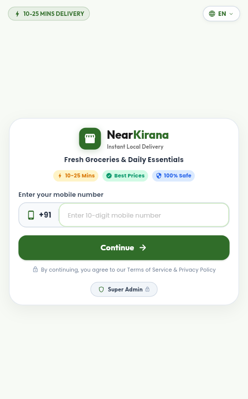 | 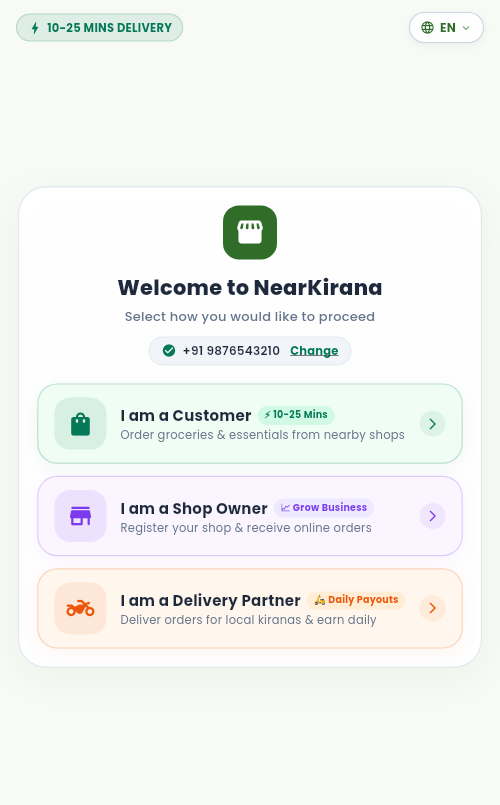 |
| **Mobile Authentication Gateway**: Clean phone number input with country code picker, 10-25 mins instant delivery value proposition, trilingual language switcher (English, Hindi, Hinglish), and discreet access to Super Admin governance. | **Multi-Tenant Role Selector**: Seamlessly routes verified users into Customer (Grahak), Kirana Merchant (Dukandar), or Delivery Fleet portals based on Firestore role permissions. |

---

### 2. Hyperlocal Store Discovery & Catalog Browsing

| Hyperlocal Store Discovery | Branded Storefront Landing |
| :---: | :---: |
| 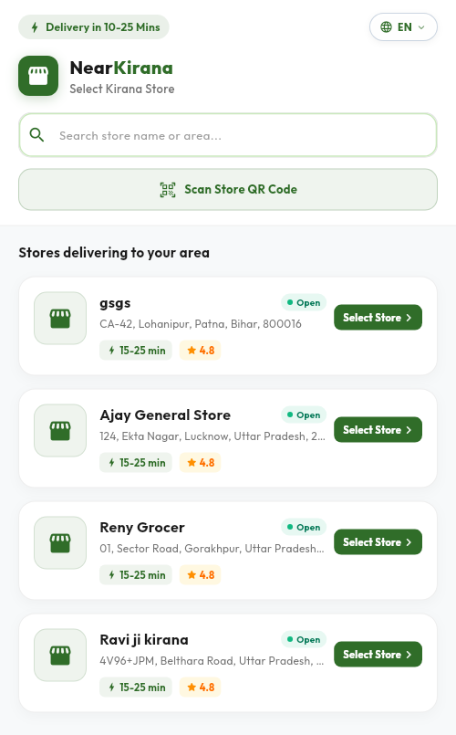 | 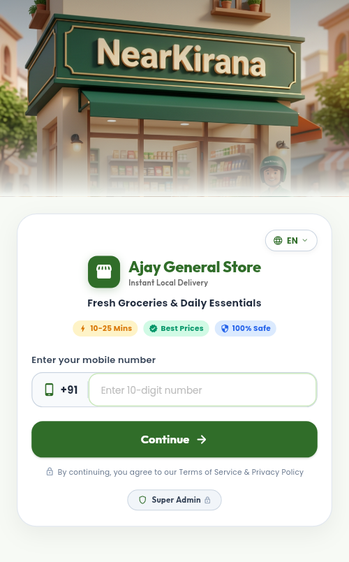 |
| **GPS Hyperlocal Store Selector**: Calculates exact road distance and estimated delivery window (e.g. 25-35 mins) within the store's delivery radius. Supports area search and counter QR code scanner for instant binding. | **Individual Storefront Branding**: Displays custom merchant header, verified badge, operating hours, delivery radius, minimum order value, and direct WhatsApp / phone contact hotline. |

| Customer Catalog & Search | Interactive Empty Cart & Voice Ordering |
| :---: | :---: |
| 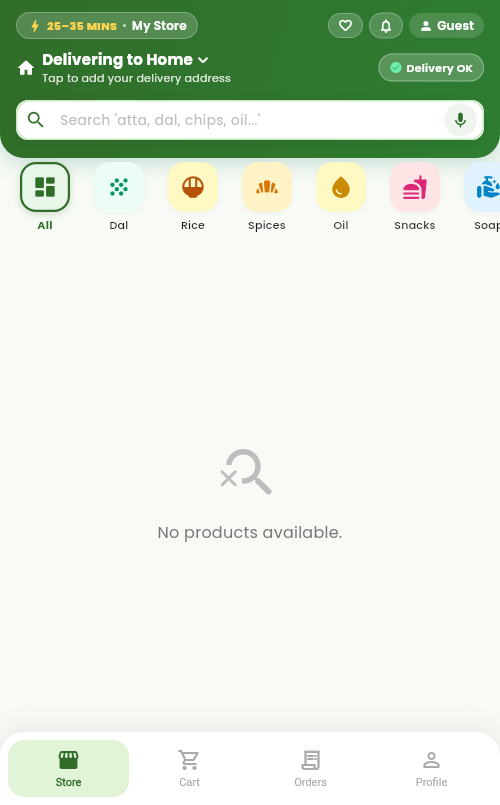 | 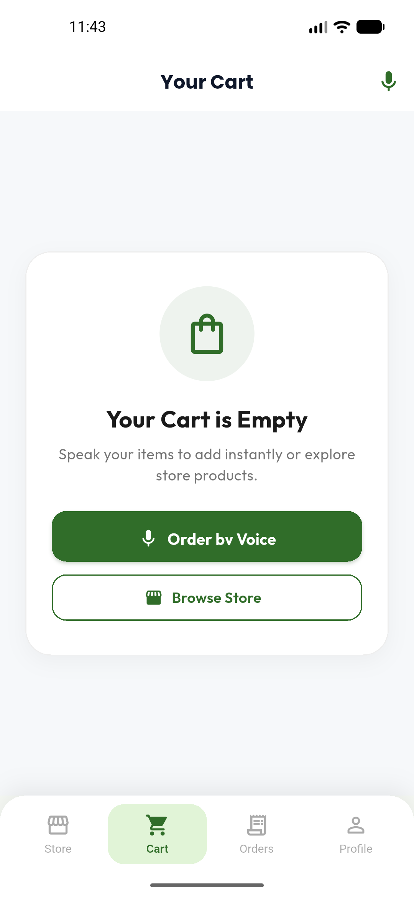 |
| **Customer Shopping Experience**: Address delivery header, category chip carousels (Atta, Rice, Spices, Snacks, Soap), substring keyword search, bilingual voice mic, and product cards with MRP, sale price, and unit steppers. | **Interactive Cart Gateway**: Frictionless cart interface featuring one-tap bilingual voice order dictation and contextual shortcuts back to the merchant's catalog. |

---

### 3. Customer Ordering, PIN Verification & Smart Lists

| Customer Live Orders & PIN Handover | Smart Shopping Lists & Reorder |
| :---: | :---: |
| 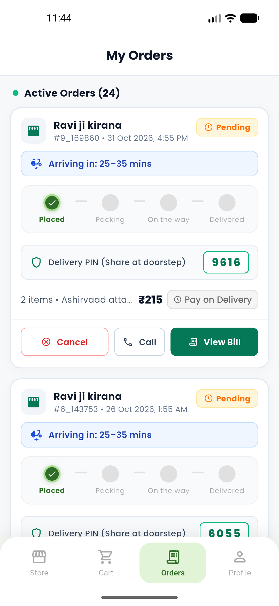 | 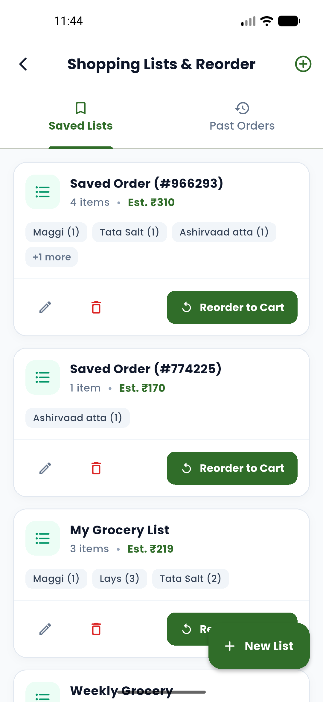 |
| **Active Orders Pipeline**: Multi-stage fulfillment stepper (Placed → Packing → On the way → Delivered), dynamic ETA countdown, downloadable PDF bill, and a confidential **4-digit doorstep delivery PIN** required for order completion. | **Recurring Grocery Lists**: Lets households create custom monthly lists or generate instant 1-tap reorders directly from previous order history with estimated basket pricing. |

| Customer Profile & Saved Addresses | Merchant Store Onboarding |
| :---: | :---: |
| 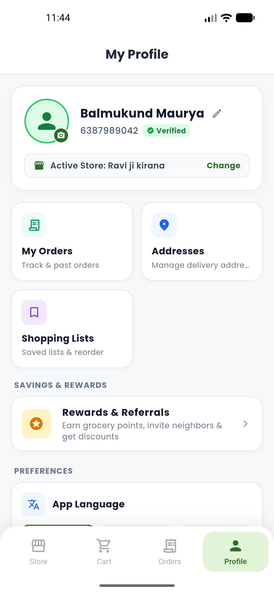 | 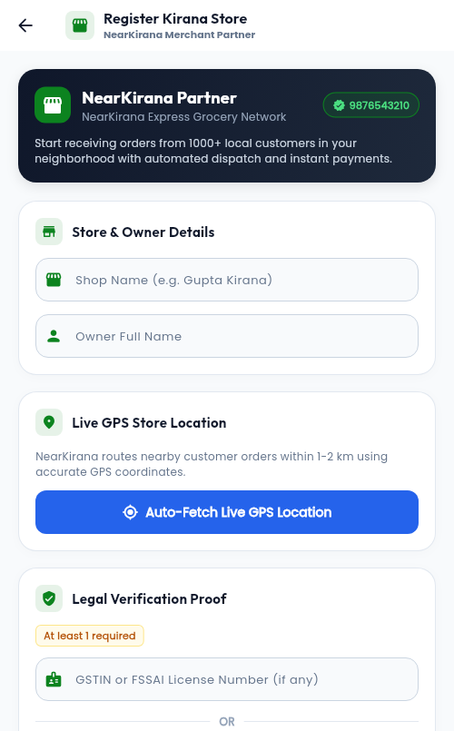 |
| **Customer Profile & Account Hub**: Displays verified phone badge, active store switch, saved address manager with GPS pin mapping, loyalty reward coin balance, and language preferences. | **Zepto/Blinkit-Inspired Store Onboarding**: Multi-step registration wizard capturing shop name, merchant legal identity (GSTIN/FSSAI), GPS coordinates, delivery radius, and minimum order rules. |

---

### 4. Merchant Control Center & Fulfillment Pipeline

| Merchant Partner Dashboard | Live Order Processing Pipeline |
| :---: | :---: |
| 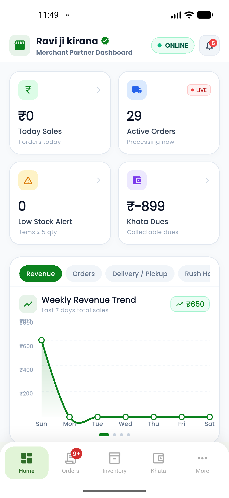 | 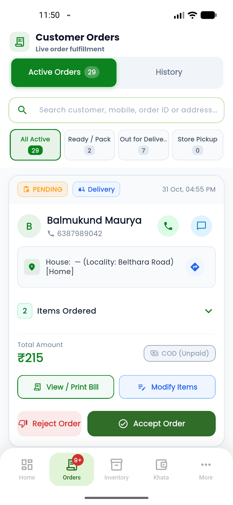 |
| **Executive Store Hub**: Real-time KPI summary (Today's Sales, Active Orders, Low Stock Alerts, Collectable Khata Dues) alongside an interactive **Weekly Revenue Trend** line chart powered by `fl_chart`. | **Live Order Dispatch Queue**: Pipeline tabs (All Active, Ready/Pack, Out for Delivery, Store Pickup). Features one-tap Accept/Reject, itemized picker lists, invoice printing, and smart out-of-stock item substitution. |

---

### 5. Store Inventory, Barcode Scanner & Batch Tracking

| Barcode Inventory & Stock Stepper | Staff Accounts & Audit Trail |
| :---: | :---: |
| 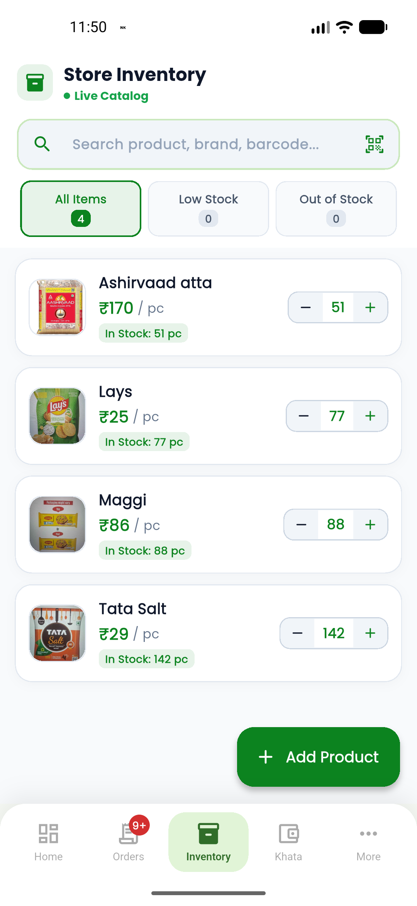 | 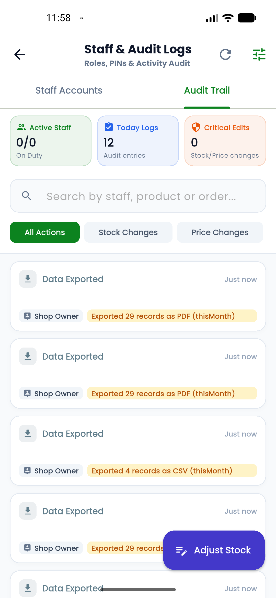 |
| **Live Catalog & Barcode Inventory**: Fast search by title, category, or barcode scan. Immediate inline stock increment/decrement steppers, low-stock threshold triggers, and new item creation. | **Staff Management & Audit Trail**: Granular employee roles (Cashier, Packer, Delivery Rider) paired with an immutable audit log recording who modified stock, prices, or discounts. |

---

### 6. Digital Khata Ledger & Financial Recovery

| Digital Khata Ledger (Udhaar Book) | Customer Accounts & Outstanding Dues |
| :---: | :---: |
| 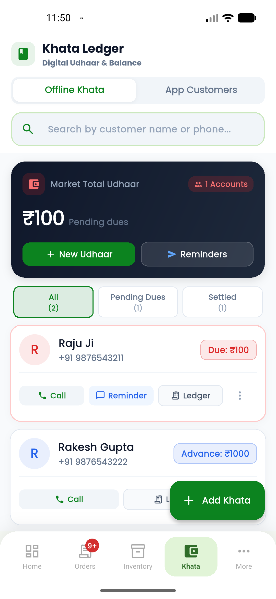 |  |
| **Digital Udhaar & Balance Ledger**: Tracks overall market dues, pending collections, and advance payments. Deep-links directly to WhatsApp with automated, localized payment reminder messages. | **Customer Directory & Credit Limits**: Unified ledger for both app users and walk-in offline customers. One-tap payment receipt recording and instant ledger transaction statements. |

---

### 7. Sales, COGS & Net Profit Analytics

| Sales, COGS & Net Profit Analytics | CA Tax & Accounting Data Export |
| :---: | :---: |
| 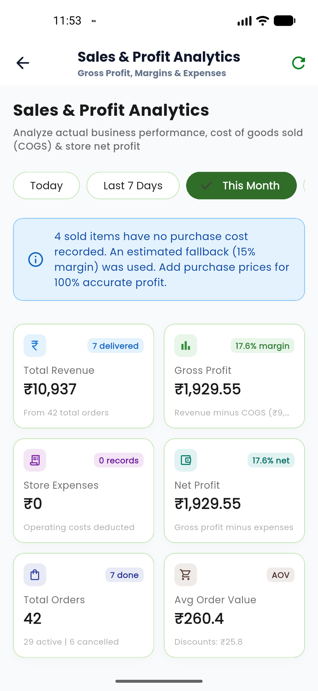 | 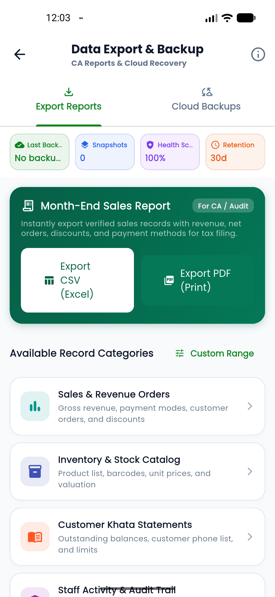 |
| **Executive Financial Analytics**: True profitability tracking combining Total Revenue, Cost of Goods Sold (COGS), Gross Profit, Operating Store Expenses, Net Profit, and Average Order Value (AOV). | **Accounting & CA Compliance Exporter**: One-click generation of month-end CSV spreadsheets and printable PDF financial statements for Chartered Accountant audit and GST tax filing. |

---

### 8. Delivery Fleet Operations & Doorstep PIN Verification

| Delivery Fleet Management | Doorstep 4-Digit Handover PIN Verification |
| :---: | :---: |
| 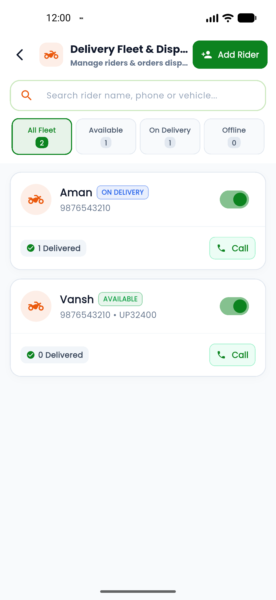 | 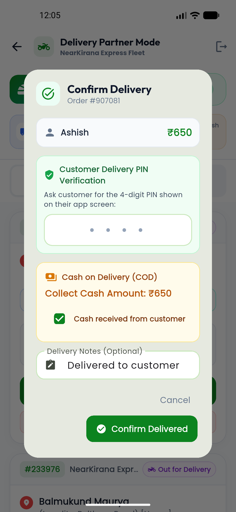 |
| **Delivery Fleet Roster**: Live rider duty toggles, current delivery assignments, vehicle registration, and direct calling hotline for real-time dispatch coordination. | **Anti-Fraud Delivery Handover**: Delivery partner verifies package delivery by submitting the customer's secret 4-digit PIN, simultaneously logging Cash on Delivery (COD) collection. |

| Delivery Partner Dispatch Portal | Platform Super Admin Governance |
| :---: | :---: |
| 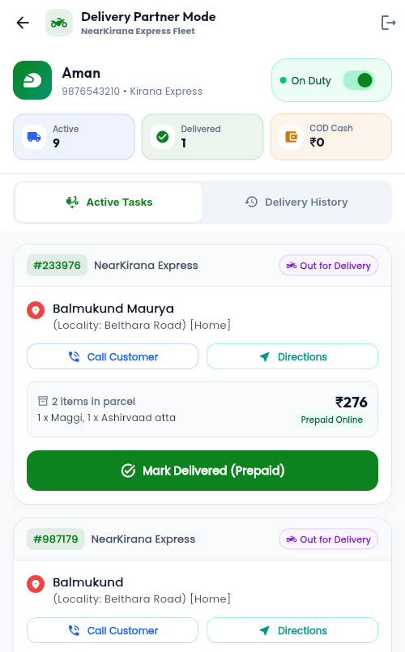 | 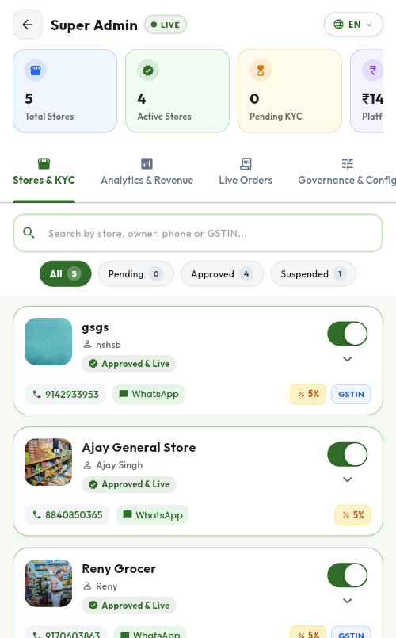 |
| **Delivery Rider Operating Mode**: Duty on/off toggle switch, assigned delivery tasks with item breakdowns, customer phone calling, and turn-by-turn road navigation via Google Maps. | **Platform Super Admin Governance**: Ecosystem-wide store verification, KYC document approvals, merchant suspension toggles, and multi-tenant performance analytics. |

---

### 9. Customer Support, Disputes & Loyalty Coins

| Customer Complaints & Dispute Resolution | Tiered Loyalty Coins & Referrals |
| :---: | :---: |
| 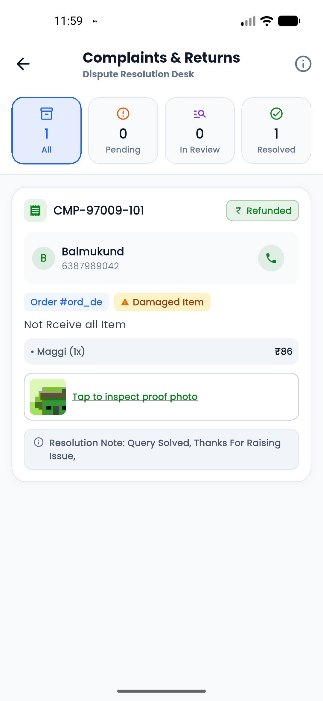 | 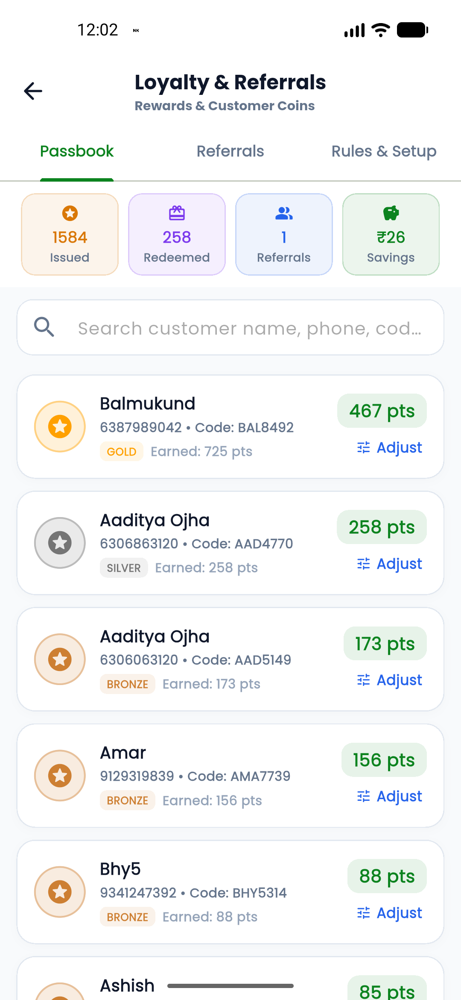 |
| **Merchant Dispute Desk**: Real-time management of customer complaints, missing or damaged item inspection with photographic proof, and direct refund authorization. | **Tiered Loyalty Program (Gold / Silver / Bronze)**: Customer coin passbook tracking earned and redeemed points, custom referral codes, and automated cart discount redemption. |

---

## ⚡ End-to-End Feature Matrix & Subsystems Breakdown

This section provides an exhaustive technical analysis of every subsystem across all **157 source files** in NearKirana.

---

### 1. Multi-Tenant Role Architecture & Access Control
- **Implementation**: [`lib/gateway_screen.dart`](file:///Users/macbook/Desktop/Kirana_Store_Builder/lib/gateway_screen.dart), [`lib/auth_service.dart`](file:///Users/macbook/Desktop/Kirana_Store_Builder/lib/auth_service.dart), [`lib/role_permissions.dart`](file:///Users/macbook/Desktop/Kirana_Store_Builder/lib/role_permissions.dart).
- **Core Capabilities**:
  - Unified mobile OTP authentication supporting country codes (+91 default).
  - Multi-tenant tenant binding: Upon login, user roles (`customer`, `shop_owner`, `shop_boy`, `delivery_partner`, `super_admin`) are queried from Firestore.
  - Role persistence in `SharedPreferences` (`app_role`, `global_phone`, `current_shop_id`) allows immediate cold-start navigation into the appropriate portal without redundant logins.
  - Discreet Super Admin elevation via cryptographically validated 4-digit master PIN.

---

### 2. Hyperlocal Geofencing & Store Discovery
- **Implementation**: [`lib/shop_selector_screen.dart`](file:///Users/macbook/Desktop/Kirana_Store_Builder/lib/shop_selector_screen.dart), [`lib/shop_provider.dart`](file:///Users/macbook/Desktop/Kirana_Store_Builder/lib/shop_provider.dart), [`lib/shop_qr_screen.dart`](file:///Users/macbook/Desktop/Kirana_Store_Builder/lib/shop_qr_screen.dart).
- **Core Capabilities**:
  - Haversine distance geofencing via `geolocator` calculates exact distance between customer GPS coordinates and registered store locations.
  - Dynamic store filtering: Hides stores outside configured delivery radius (e.g. 1.0 km to 5.0 km) or stores currently toggled "Offline".
  - Area / Pincode manual override allows customers to browse stores in neighboring localities.
  - Physical In-Store Counter QR Code Scanning binds the customer directly to a specific merchant's catalog upon scanning.

---

### 3. Customer Shopping & Bilingual Voice-to-Cart NLP
- **Implementation**: [`lib/customer_shop_tab.dart`](file:///Users/macbook/Desktop/Kirana_Store_Builder/lib/customer_shop_tab.dart), [`lib/voice_order_parser.dart`](file:///Users/macbook/Desktop/Kirana_Store_Builder/lib/voice_order_parser.dart), [`lib/voice_order_service.dart`](file:///Users/macbook/Desktop/Kirana_Store_Builder/lib/voice_order_service.dart).
- **Core Capabilities**:
  - Real-time catalog browsing with horizontal category pills: *Atta, Dal, Rice, Spices, Oil, Snacks, Soap, Dairy*.
  - Substring search indexing: Firestore `search_keywords` array allows instant keyword autocomplete as the user types.
  - Unit support: Itemized display of packaged vs loose items (kg, g, packet, litre, pc).
  - **Bilingual NLP Voice Ordering**:
    - Supports spoken Hindi, English, and Hinglish dictation (*"Do packet doodh aur ek kilo cheeni"*).
    - Regex phonetic entity extractor normalizes spoken quantities (*"ek"*, *"do"*, *"aadha"* -> `1`, `2`, `0.5`) and maps product entities directly into `CartProvider`.

---

### 4. Cart Calculations, Dynamic Fees & Tiered Delivery
- **Implementation**: [`lib/cart_provider.dart`](file:///Users/macbook/Desktop/Kirana_Store_Builder/lib/cart_provider.dart), [`lib/cart_calculator.dart`](file:///Users/macbook/Desktop/Kirana_Store_Builder/lib/cart_calculator.dart), [`lib/cart_screen.dart`](file:///Users/macbook/Desktop/Kirana_Store_Builder/lib/cart_screen.dart).
- **Core Capabilities**:
  - Deterministic basket calculation: Subtotal, item-level discounts, coupon deductions, and loyalty coin redemption.
  - Minimum order threshold validation (e.g., minimum ₹99 order for checkout).
  - Tiered delivery fee calculation:
    - Order > ₹499: **Free Delivery**.
    - Order ₹200 – ₹499: Standard ₹25 delivery fee.
    - Order < ₹200: Small cart delivery fee of ₹40.
  - Stock validation prevents checking out more units than currently recorded in inventory.

---

### 5. Transparent Delivery Time Estimation Engine
- **Implementation**: [`lib/delivery_estimation_service.dart`](file:///Users/macbook/Desktop/Kirana_Store_Builder/lib/delivery_estimation_service.dart), [`lib/delivery_estimate_model.dart`](file:///Users/macbook/Desktop/Kirana_Store_Builder/lib/delivery_estimate_model.dart).
- **Core Capabilities**:
  - Decomposes delivery time into three realistic components:
    $$\text{Total Time} = \text{Prep Time (10-15m)} + \text{Transit Time (OSRM GPS)} + \text{Queue Delay (Active Orders)}$$
  - Formats user-facing approximate window string (e.g. *"25–35 mins"*).
  - Handles legal transparency disclaimer: *"Approximate time window. Traffic, weather & rush volume may cause variations. Not a strict guarantee."*

---

### 6. Multi-Modal Payment Gateway & In-Store Standee QR
- **Implementation**: [`lib/razorpay_service.dart`](file:///Users/macbook/Desktop/Kirana_Store_Builder/lib/razorpay_service.dart), [`lib/payment_service.dart`](file:///Users/macbook/Desktop/Kirana_Store_Builder/lib/payment_service.dart), [`lib/receive_payment_screen.dart`](file:///Users/macbook/Desktop/Kirana_Store_Builder/lib/receive_payment_screen.dart).
- **Core Capabilities**:
  - **Razorpay SDK Integration**: Supports Credit/Debit Cards, NetBanking, and Wallets.
  - **UPI Deep-Linking**: Invokes Google Pay, PhonePe, and Paytm via standard Android Intent URI (`upi://pay?pa=...&pn=...&am=...&cu=INR`).
  - **Dynamic In-Store QR Standee**: Renders a vector QR code containing the merchant's VPA and order amount for counter scanning.
  - **Cash on Delivery (COD)**: Handover verification managed by delivery agent.
  - **Khata Settlement**: Registered customers can settle orders directly against their credit line balance.

---

### 7. Order Lifecycle FSM & ACID Atomic Transactions
- **Implementation**: [`lib/order_state_machine.dart`](file:///Users/macbook/Desktop/Kirana_Store_Builder/lib/order_state_machine.dart), [`lib/atomic_order_service.dart`](file:///Users/macbook/Desktop/Kirana_Store_Builder/lib/atomic_order_service.dart).
- **Core Capabilities**:
  - **ACID Firestore Transactions**: `runTransaction` locks inventory documents, verifies real-time stock levels, decrements quantities, and generates the order document atomically.
  - **Deterministic FSM**: Enforces valid transitions:
    `pending` → `accepted` → `packing` → `out_for_delivery` → `delivered`.
  - **Cancellation Rollback**: If an order is rejected or cancelled, item units are atomically restored to inventory, and redeemed loyalty coins are credited back.
  - **Doorstep Verification**: The transition to `delivered` strictly requires matching the 4-digit secret PIN inside an atomic transaction.

---

### 8. Real-Time OSRM Road Navigation & Live GPS Tracking
- **Implementation**: [`lib/customer_live_tracking_screen.dart`](file:///Users/macbook/Desktop/Kirana_Store_Builder/lib/customer_live_tracking_screen.dart), [`lib/road_routing_service.dart`](file:///Users/macbook/Desktop/Kirana_Store_Builder/lib/road_routing_service.dart), [`lib/live_delivery_tracking_service.dart`](file:///Users/macbook/Desktop/Kirana_Store_Builder/lib/live_delivery_tracking_service.dart).
- **Core Capabilities**:
  - OSRM (Open Source Routing Machine) polyline route calculation between store and customer coordinates.
  - Real-time location stream from delivery rider's phone updates driver marker on `flutter_map`.
  - Dynamic bearing interpolation rotates motorcycle icon along turn-by-turn road curves.
  - Real-time ETA updates as driver navigates traffic.

---

### 9. Real-Time Product Substitution Engine
- **Implementation**: [`lib/product_substitution_service.dart`](file:///Users/macbook/Desktop/Kirana_Store_Builder/lib/product_substitution_service.dart), [`lib/substitution_model.dart`](file:///Users/macbook/Desktop/Kirana_Store_Builder/lib/substitution_model.dart), [`lib/widgets/substitution_widgets.dart`](file:///Users/macbook/Desktop/Kirana_Store_Builder/lib/widgets/substitution_widgets.dart).
- **Core Capabilities**:
  - Handles out-of-stock items during order packing.
  - Merchant selects an alternative product from the same category.
  - Creates a `ProductSubstitutionProposal` document linked to the order.
  - Customer receives real-time UI notification to **Accept** or **Reject** the proposed substitute.
  - Price adjustment is automatically recalculated before dispatch.

---

### 10. Barcode Scanner & Real-Time Stock Management
- **Implementation**: [`lib/shop_stock_screen.dart`](file:///Users/macbook/Desktop/Kirana_Store_Builder/lib/shop_stock_screen.dart), [`lib/admin_product_forms.dart`](file:///Users/macbook/Desktop/Kirana_Store_Builder/lib/admin_product_forms.dart), [`lib/admin_add_product_screen.dart`](file:///Users/macbook/Desktop/Kirana_Store_Builder/lib/admin_add_product_screen.dart).
- **Core Capabilities**:
  - Camera-based barcode scanner decodes EAN-13, UPC-A, and Code 128 barcodes to immediately locate items in inventory.
  - Rapid stock adjustment: Inline `[ - ] [ count ] [ + ]` stepper buttons for high-speed stock intake at the shop counter.
  - Visual status chips: *All Items*, *Low Stock (<= 5 units)*, *Out of Stock (0 units)*.
  - Product creation wizard with wholesale cost (COGS), MRP, sale price, weight, and image upload.

---

### 11. Batch Tracking, Expiry Urgency & Markdown Disposal
- **Implementation**: [`lib/admin_batch_expiry_screen.dart`](file:///Users/macbook/Desktop/Kirana_Store_Builder/lib/admin_batch_expiry_screen.dart), [`lib/batch_service.dart`](file:///Users/macbook/Desktop/Kirana_Store_Builder/lib/batch_service.dart), [`lib/batch_models.dart`](file:///Users/macbook/Desktop/Kirana_Store_Builder/lib/batch_models.dart).
- **Core Capabilities**:
  - Granular batch tracking: Records Batch ID, Manufacturing Date, and Expiry Date for perishable goods (dairy, bread, packaged flour).
  - **Expiry Urgency Categorization**:
    - *Expired* (Past expiry date)
    - *Critical* (<= 7 Days remaining)
    - *Warning* (8 to 15 Days remaining)
    - *Attention* (16 to 30 Days remaining)
    - *Safe* (> 30 Days remaining)
  - **Near-Expiry Markdown Engine**: Automatically proposes discount percentages (e.g. 20% to 50% off) to liquidate items before expiration.
  - **Disposal Logging**: Records destroyed or written-off batches in the store loss ledger.

---

### 12. Supplier Procurement & Accounts Payable ERP
- **Implementation**: [`lib/admin_suppliers_screen.dart`](file:///Users/macbook/Desktop/Kirana_Store_Builder/lib/admin_suppliers_screen.dart), [`lib/supplier_service.dart`](file:///Users/macbook/Desktop/Kirana_Store_Builder/lib/supplier_service.dart), [`lib/supplier_models.dart`](file:///Users/macbook/Desktop/Kirana_Store_Builder/lib/supplier_models.dart).
- **Core Capabilities**:
  - FMCG Distributor Directory: Stores distributor names, contacts, GSTIN numbers, and credit terms.
  - **Purchase Order (PO) Lifecycle**: Tracks orders across `draft` → `ordered` → `received` → `cancelled`.
  - **Accounts Payable Ledger**: Tracks total procurement invoiced amount, payments made, and outstanding balance owed to each supplier.
  - Receiving workflow: One-tap intake automatically updates store inventory stock levels and wholesale COGS purchase prices.

---

### 13. Digital Khata Ledger & Automated WhatsApp Dunning
- **Implementation**: [`lib/khata_screen.dart`](file:///Users/macbook/Desktop/Kirana_Store_Builder/lib/khata_screen.dart), [`lib/khata_statement_screen.dart`](file:///Users/macbook/Desktop/Kirana_Store_Builder/lib/khata_statement_screen.dart), [`lib/admin_whatsapp_reminder_screen.dart`](file:///Users/macbook/Desktop/Kirana_Store_Builder/lib/admin_whatsapp_reminder_screen.dart).
- **Core Capabilities**:
  - Manages both online app customers and walk-in offline counter customers.
  - Records debit transactions (groceries taken on credit) and credit transactions (cash/UPI repayments).
  - Market total balance dashboard: Displays net pending market credit vs customer advance balances.
  - **Automated WhatsApp Reminders**: Generates localized Hindi/English payment reminder messages with merchant UPI VPA link, invoking WhatsApp via direct intent deep link.
  - PDF account statements formatted for customer WhatsApp sharing or physical receipt printing.

---

### 14. Retail Financial Analytics (FIFO COGS & Net Profit)
- **Implementation**: [`lib/admin_analytics_screen.dart`](file:///Users/macbook/Desktop/Kirana_Store_Builder/lib/admin_analytics_screen.dart), [`lib/analytics_service.dart`](file:///Users/macbook/Desktop/Kirana_Store_Builder/lib/analytics_service.dart), [`lib/analytics_models.dart`](file:///Users/macbook/Desktop/Kirana_Store_Builder/lib/analytics_models.dart).
- **Core Capabilities**:
  - Computes true retail profitability beyond simple top-line sales:
    $$\text{Gross Profit} = \text{Total Delivered Revenue} - \text{COGS (Wholesale Purchase Prices)}$$
    $$\text{Net Profit} = \text{Gross Profit} - \text{Operating Store Expenses}$$
  - Expense Logger (`widgets/add_expense_dialog.dart`): Categorizes overheads (Rent, Electricity, Staff Wages, Fuel, Packaging).
  - Aggregates Average Order Value (AOV), total discount burn, and delivered order counts.
  - Rush hour heatmaps identify peak order placement hours to optimize staff and rider rosters.

---

### 15. CA Tax Audit & Month-End Backup Exporter (CSV/PDF)
- **Implementation**: [`lib/admin_data_export_backup_screen.dart`](file:///Users/macbook/Desktop/Kirana_Store_Builder/lib/admin_data_export_backup_screen.dart), [`lib/data_export_backup_service.dart`](file:///Users/macbook/Desktop/Kirana_Store_Builder/lib/data_export_backup_service.dart), [`lib/data_export_backup_models.dart`](file:///Users/macbook/Desktop/Kirana_Store_Builder/lib/data_export_backup_models.dart).
- **Core Capabilities**:
  - One-click month-end report generation for Chartered Accountant (CA) review and GST tax filings.
  - Exports data across four distinct categories:
    1. *Sales & Revenue Orders* (Order IDs, customer phones, taxes, payment modes)
    2. *Inventory & Stock Catalog* (SKUs, barcodes, current stock, inventory valuation)
    3. *Customer Khata Statements* (Outstanding credit balances, payment logs)
    4. *Staff Activity & Audit Trail* (Security and compliance audit history)
  - Supports CSV format for Microsoft Excel and vector PDF for printing and signing.

---

### 16. Delivery Partner Fleet Management & Anti-Fraud PIN
- **Implementation**: [`lib/delivery_partner_screen.dart`](file:///Users/macbook/Desktop/Kirana_Store_Builder/lib/delivery_partner_screen.dart), [`lib/delivery_partner_service.dart`](file:///Users/macbook/Desktop/Kirana_Store_Builder/lib/delivery_partner_service.dart), [`lib/delivery_partner_models.dart`](file:///Users/macbook/Desktop/Kirana_Store_Builder/lib/delivery_partner_models.dart).
- **Core Capabilities**:
  - Dedicated mobile portal for delivery boys with real-time On Duty / Off Duty toggle.
  - Active task queue displaying pickup address, customer address, package contents, and payment status.
  - Direct customer phone calling hotline and one-tap turn-by-turn navigation via external Google Maps intent.
  - **4-Digit Doorstep Delivery PIN Verification**: Prevents package theft or false delivery claims by requiring the customer's PIN to finalize delivery.
  - Cash on Delivery (COD) cash collection logging with daily rider reconciliation.

---

### 17. Customer Dispute Resolution Desk & Return Proofs
- **Implementation**: [`lib/admin_complaints_screen.dart`](file:///Users/macbook/Desktop/Kirana_Store_Builder/lib/admin_complaints_screen.dart), [`lib/complaint_service.dart`](file:///Users/macbook/Desktop/Kirana_Store_Builder/lib/complaint_service.dart), [`lib/complaint_model.dart`](file:///Users/macbook/Desktop/Kirana_Store_Builder/lib/complaint_model.dart).
- **Core Capabilities**:
  - Customer dispute ticketing for damaged goods, missing items, or delivery delays.
  - Photo proof inspection: Store owners inspect customer-uploaded photos of damaged goods.
  - Status progression: `pending` → `in_review` → `refunded` → `rejected`.
  - Resolution notes recording and automatic Khata credit or UPI refund triggers.

---

### 18. Tiered Loyalty Points (Gold/Silver/Bronze) & Referrals
- **Implementation**: [`lib/admin_loyalty_screen.dart`](file:///Users/macbook/Desktop/Kirana_Store_Builder/lib/admin_loyalty_screen.dart), [`lib/loyalty_referral_service.dart`](file:///Users/macbook/Desktop/Kirana_Store_Builder/lib/loyalty_referral_service.dart), [`lib/loyalty_referral_models.dart`](file:///Users/macbook/Desktop/Kirana_Store_Builder/lib/loyalty_referral_models.dart).
- **Core Capabilities**:
  - Customers earn loyalty coins on every completed order based on merchant rules.
  - Automatic tier promotion:
    - *Bronze*: Entry level tier.
    - *Silver*: > 200 points earned (5% bonus coin accumulation).
    - *Gold*: > 500 points earned (10% bonus coin accumulation).
  - Referral code system: Generates unique customer referral codes rewarding both referrer and referee.
  - Coin redemption at checkout for direct rupee discounts on grocery bills.

---

### 19. Coupons, Discounts & Promotional Campaign Engine
- **Implementation**: [`lib/admin_discounts_screen.dart`](file:///Users/macbook/Desktop/Kirana_Store_Builder/lib/admin_discounts_screen.dart), [`lib/coupon_service.dart`](file:///Users/macbook/Desktop/Kirana_Store_Builder/lib/coupon_service.dart), [`lib/coupon_model.dart`](file:///Users/macbook/Desktop/Kirana_Store_Builder/lib/coupon_model.dart).
- **Core Capabilities**:
  - Supported discount types: Flat Rupee OFF (₹50 OFF), Percentage OFF (10% OFF), and Free Delivery.
  - Advanced restriction controls: Minimum cart value threshold, maximum discount cap, and start/end validity dates.
  - Usage limits: Global campaign usage caps and per-user limits (e.g. 1 redemption per customer).
  - Real-time coupon validation prevents expired or invalid promo code redemption.

---

### 20. Customer Ratings & Multi-Aspect Reviews
- **Implementation**: [`lib/rating_review_service.dart`](file:///Users/macbook/Desktop/Kirana_Store_Builder/lib/rating_review_service.dart), [`lib/review_model.dart`](file:///Users/macbook/Desktop/Kirana_Store_Builder/lib/review_model.dart).
- **Core Capabilities**:
  - 5-star rating system with text comments submitted by verified buyers.
  - Multi-aspect evaluation: Rates overall store service, delivery rider punctuality, and individual purchased products.
  - Aggregated store score and product ratings displayed on customer shopping cards.

---

### 21. Recurring Smart Shopping Lists & One-Tap Reordering
- **Implementation**: [`lib/shopping_lists_screen.dart`](file:///Users/macbook/Desktop/Kirana_Store_Builder/lib/shopping_lists_screen.dart), [`lib/shopping_list_service.dart`](file:///Users/macbook/Desktop/Kirana_Store_Builder/lib/shopping_list_service.dart), [`lib/shopping_list_model.dart`](file:///Users/macbook/Desktop/Kirana_Store_Builder/lib/shopping_list_model.dart).
- **Core Capabilities**:
  - Custom list creation: Households create categorized lists (*"Monthly Ration"*, *"Weekly Vegetables"*).
  - 1-Tap Reorder: Converts completed historical orders into new shopping lists or injects items directly into the current active cart.
  - Dynamic price estimation updates list totals based on the active store's real-time inventory prices.

---

### 22. Staff Accounts, Role Delegation & Immutable Audit Trail
- **Implementation**: [`lib/admin_shop_boys_screen.dart`](file:///Users/macbook/Desktop/Kirana_Store_Builder/lib/admin_shop_boys_screen.dart), [`lib/admin_staff_audit_screen.dart`](file:///Users/macbook/Desktop/Kirana_Store_Builder/lib/admin_staff_audit_screen.dart), [`lib/staff_audit_service.dart`](file:///Users/macbook/Desktop/Kirana_Store_Builder/lib/staff_audit_service.dart), [`lib/staff_audit_models.dart`](file:///Users/macbook/Desktop/Kirana_Store_Builder/lib/staff_audit_models.dart).
- **Core Capabilities**:
  - Shop employee accounts with 4-digit login PINs and assigned roles (`Cashier`, `Packer`, `Delivery Boy`).
  - Granular permissions: Toggle access to Billing, Stock Modification, Order Packing, and Khata Entry.
  - **Immutable Audit Trail**: Logs critical shop events (manual inventory adjustments, price edits, discount overrides) with timestamp, staff ID, and old vs new values.

---

### 23. Audio Chimes & FCM Push Notifications
- **Implementation**: [`lib/notification_service.dart`](file:///Users/macbook/Desktop/Kirana_Store_Builder/lib/notification_service.dart), [`lib/sound_service.dart`](file:///Users/macbook/Desktop/Kirana_Store_Builder/lib/sound_service.dart).
- **Core Capabilities**:
  - Firebase Cloud Messaging (FCM) push notifications deliver order updates and delivery notifications in real time.
  - **In-App Audio Chimes**: Plays local audio chimes (`assets/sounds/order_bell.mp3`) alerting kirana merchants whenever a new order is received at the counter.
  - In-app notification center provides an audit log of alerts, reminders, and promotional updates.

---

### 24. Customer Wishlist & Offline Cross-Session Cache
- **Implementation**: [`lib/wishlist_provider.dart`](file:///Users/macbook/Desktop/Kirana_Store_Builder/lib/wishlist_provider.dart), [`lib/desktop_wishlist_view.dart`](file:///Users/macbook/Desktop/Kirana_Store_Builder/lib/desktop_wishlist_view.dart).
- **Core Capabilities**:
  - One-tap item bookmarking on catalog cards.
  - Cross-session persistence using encrypted `SharedPreferences` cache.
  - One-tap *"Move all Wishlist items to Cart"* streamlining repeat grocery purchases.

---

### 25. Desktop & Tablet Split-Pane Adaptive Architecture
- **Implementation**: [`lib/admin_desktop_dashboard.dart`](file:///Users/macbook/Desktop/Kirana_Store_Builder/lib/admin_desktop_dashboard.dart), [`lib/customer_desktop_dashboard.dart`](file:///Users/macbook/Desktop/Kirana_Store_Builder/lib/customer_desktop_dashboard.dart), [`lib/desktop_checkout_view.dart`](file:///Users/macbook/Desktop/Kirana_Store_Builder/lib/desktop_checkout_view.dart), [`lib/desktop_khata_view.dart`](file:///Users/macbook/Desktop/Kirana_Store_Builder/lib/desktop_khata_view.dart), [`lib/desktop_order_details_view.dart`](file:///Users/macbook/Desktop/Kirana_Store_Builder/lib/desktop_order_details_view.dart).
- **Core Capabilities**:
  - Responsive screen layout: Automatically branches UI when screen width exceeds 900px.
  - Desktop admin ERP mode: Persistent left sidebar navigation, multi-column order grid, and right-hand live invoice inspection panel.
  - Desktop customer portal: Two-column checkout layout with simultaneous map pin inspection and live cart summary.

---

### 26. Platform Super Admin Oversight & KYC Verification
- **Implementation**: [`lib/super_admin_screen.dart`](file:///Users/macbook/Desktop/Kirana_Store_Builder/lib/super_admin_screen.dart).
- **Core Capabilities**:
  - Platform-wide store oversight across all registered kirana shops.
  - Merchant verification desk: Inspects uploaded GSTIN certificates, FSSAI licenses, and merchant identity documents.
  - Remote store kill-switch: Can suspend or reactivate stores violating platform hygiene or safety policies.
  - Ecosystem performance metrics: Monitors platform gross merchandise value (GMV) and commission accrual.

---

### 27. Trilingual Localization (English, Hindi, Hinglish)
- **Implementation**: [`lib/l10n/`](file:///Users/macbook/Desktop/Kirana_Store_Builder/lib/l10n), [`lib/language_provider.dart`](file:///Users/macbook/Desktop/Kirana_Store_Builder/lib/language_provider.dart), [`lib/widgets/language_bottom_sheet.dart`](file:///Users/macbook/Desktop/Kirana_Store_Builder/lib/widgets/language_bottom_sheet.dart).
- **Core Capabilities**:
  - Official Flutter `l10n` ARB integration supporting English (`en`), Hindi (`hi`), and conversational Hinglish.
  - Dynamic language switching at runtime without app restart.
  - Localized currency and measurement conventions (*₹, किलो, ग्राम, पैकेट*).

---

### 28. Crash Reporting & Observability Telemetry
- **Implementation**: [`lib/crash_reporting_service.dart`](file:///Users/macbook/Desktop/Kirana_Store_Builder/lib/crash_reporting_service.dart).
- **Core Capabilities**:
  - Centralized error capture: Records unhandled Flutter and Dart zone errors.
  - Attaches contextual device state (OS version, active role, current store ID, network status).
  - Safe production fail-soft logging preventing user-facing UI freezes.

---

## 📐 Comprehensive Data Models & Class Specifications

NearKirana is engineered with strictly-typed domain models across all business domains:

| Domain | Model Class / File | Key Attributes & Enums |
|---|---|---|
| **Procurement** | `PurchaseOrder`, `SupplierModel` ([`supplier_models.dart`](file:///Users/macbook/Desktop/Kirana_Store_Builder/lib/supplier_models.dart)) | `id`, `supplierId`, `items`, `totalAmount`, `status` (`PurchaseOrderStatus`: draft, ordered, received, cancelled), `paymentStatus` (`PaymentStatus`: unpaid, partial, paid), `invoiceNumber`. |
| **Batch & Expiry** | `ProductBatch`, `BatchStatus` ([`batch_models.dart`](file:///Users/macbook/Desktop/Kirana_Store_Builder/lib/batch_models.dart)) | `id`, `productId`, `batchNumber`, `manufacturingDate`, `expiryDate`, `quantity`, `purchasePrice`, `status` (`BatchStatus`), `urgency` (`ExpiryUrgency`: expired, critical, warning, attention, safe). |
| **Substitution** | `ProductSubstitutionProposal` ([`substitution_model.dart`](file:///Users/macbook/Desktop/Kirana_Store_Builder/lib/substitution_model.dart)) | `id`, `orderId`, `originalProductId`, `originalPrice`, `substituteProductId`, `substitutePrice`, `status` (`SubstitutionStatus`: pending, accepted, rejected, cancelled), `rejectionAction`. |
| **Coupons** | `CouponModel` ([`coupon_model.dart`](file:///Users/macbook/Desktop/Kirana_Store_Builder/lib/coupon_model.dart)) | `id`, `code`, `description`, `type` (`CouponDiscountType`: flat, percentage, freeDelivery), `discountValue`, `minOrderValue`, `maxDiscount`, `usageLimit`, `usedCount`, `perUserLimit`. |
| **Delivery ETA** | `DeliveryEstimate` ([`delivery_estimate_model.dart`](file:///Users/macbook/Desktop/Kirana_Store_Builder/lib/delivery_estimate_model.dart)) | `minMinutes`, `maxMinutes`, `prepTimeMinutes`, `transitTimeMinutes`, `queueDelayMinutes`, `distanceKm`, `isStoreOpen`, `deliveryType`, `formattedWindow`, `disclaimer`. |
| **Reviews** | `ReviewModel`, `ProductReviewItem` ([`review_model.dart`](file:///Users/macbook/Desktop/Kirana_Store_Builder/lib/review_model.dart)) | `id`, `orderId`, `shopId`, `customerPhone`, `overallRating`, `deliveryRating`, `items` (List of `ProductReviewItem`: `productId`, `rating`, `comment`), `createdAt`. |
| **Khata Credit** | `KhataCustomer`, `KhataTransaction` ([`khata_screen.dart`](file:///Users/macbook/Desktop/Kirana_Store_Builder/lib/khata_screen.dart)) | `customerId`, `shopId`, `name`, `phone`, `currentBalance`, `totalCreditGiven`, `totalRepaid`, `lastPaymentDate`, `transactionType` (debit, credit), `note`. |
| **Shopping Lists**| `ShoppingList`, `ShoppingListItem` ([`shopping_list_model.dart`](file:///Users/macbook/Desktop/Kirana_Store_Builder/lib/shopping_list_model.dart)) | `id`, `name`, `customerPhone`, `shopId`, `items` (List of `ShoppingListItem`: `productId`, `name`, `price`, `quantity`, `isLoose`), `colorTag`, `createdAt`. |
| **Staff Audit** | `StaffAuditLogEntry` ([`staff_audit_models.dart`](file:///Users/macbook/Desktop/Kirana_Store_Builder/lib/staff_audit_models.dart)) | `id`, `shopId`, `staffId`, `staffName`, `role`, `actionType` (stock_edit, price_change, order_override), `entityId`, `oldValue`, `newValue`, `timestamp`. |
| **Financials** | `DailyFinancialSummary` ([`analytics_models.dart`](file:///Users/macbook/Desktop/Kirana_Store_Builder/lib/analytics_models.dart)) | `date`, `totalRevenue`, `cogs`, `grossProfit`, `operatingExpenses`, `netProfit`, `ordersDelivered`, `aov`, `discountsBurned`. |
| **Invoicing** | `InvoiceData`, `InvoiceLineItem` ([`invoice_model.dart`](file:///Users/macbook/Desktop/Kirana_Store_Builder/lib/invoice_model.dart)) | `invoiceNumber`, `shopName`, `gstin`, `fssai`, `orderDate`, `customerAddress`, `lineItems`, `taxableValue`, `cgst`, `sgst`, `grandTotal`, `qrCodePayload`. |

---

## 🗄️ Firestore Database Schema

The Firestore multi-tenant schema is partitioned around `shop_id` with subcollections for high isolation:

```
firestore/
├── shops/{shopId}                       # Store profiles, geofence, hours & VPA
├── products/{productId}                 # Catalog items indexed by shop_id & keywords
├── orders/{orderId}                     # Orders with status, items, PIN & delivery
├── users/{phone}                        # User profiles, saved addresses, roles
├── khata/{khataId}                      # Store credit ledgers with customer balances
│   └── transactions/{txId}              # Subcollection of credit/debit transaction history
├── suppliers/{supplierId}               # FMCG distributor profiles & credit terms
│   ├── purchase_orders/{poId}           # Subcollection of procurement orders
│   └── payments/{paymentId}             # Subcollection of distributor payments
├── batches/{batchId}                    # Product batches, expiry dates & status
├── complaints/{complaintId}             # Customer dispute tickets with proof photos
├── coupons/{couponId}                   # Promo codes, percentage caps & validity
├── reviews/{reviewId}                   # Verified customer store & product ratings
├── shopping_lists/{listId}              # Customer recurring grocery baskets
└── staff_audit/{auditId}                # Immutable employee activity logs
```

---

## 🔒 Security Rules & Tenant Boundary Isolation

The [`firestore.rules`](file:///Users/macbook/Desktop/Kirana_Store_Builder/firestore.rules) file enforces multi-tenant enterprise data boundaries:
1. **Multi-Tenant Shop Isolation**: Merchants and shop boys can only read, write, or query products, orders, and khata records where `resource.data.shop_id == request.auth.token.shopId`.
2. **Doorstep Delivery PIN Confidentiality**: The order's 4-digit `delivery_pin` is strictly readable only by the customer who placed the order and the backend atomic verification function; it is hidden from delivery rider order lists.
3. **Audit Log Immutability**: Documents in `staff_audit` are strictly `create`-only; updates and deletions are permanently blocked by security rules to preserve compliance integrity.
4. **Super Admin Guardrails**: Elevation to `super_admin` requires cryptographically verified master PIN tokens stored in protected admin config collections.

---

## 📂 Project Directory Structure

```text
NearKirana/
├── android/                             # Android Gradle workspace & manifest assets
├── ios/                                 # iOS Xcode project & CocoaPods configuration
├── web/                                 # Progressive Web App (PWA) manifest & index.html
├── assets/
│   ├── images/                          # Branding, category illustrations & placeholders
│   ├── lottie/                          # Animated Lottie illustrations
│   └── sounds/                          # Local order bell chime assets (order_bell.mp3)
├── docs/
│   └── screenshots/                     # 23 authentic high-resolution app screenshots
├── lib/
│   ├── l10n/                            # Trilingual localization ARB files (en, hi)
│   ├── utils/                           # Shared UI utilities, snacks, and widgets
│   ├── widgets/                         # Reusable UI component library (35+ widgets)
│   ├── address_selection_bottom_sheet.dart # Interactive GPS map address picker
│   ├── admin_analytics_screen.dart      # COGS, gross/net profit analytics
│   ├── admin_batch_expiry_screen.dart   # Expiry dates & batch markdown manager
│   ├── admin_complaints_screen.dart     # Dispute resolution desk
│   ├── admin_dashboard.dart             # Merchant mobile ERP control center
│   ├── admin_desktop_dashboard.dart     # Adaptive desktop split-pane layout
│   ├── admin_discounts_screen.dart      # Promotional coupon campaign manager
│   ├── admin_home_tab.dart              # Merchant KPI cards & weekly sales chart
│   ├── admin_order_card.dart            # Live order card with state actions
│   ├── admin_orders_tab.dart            # Order processing pipeline
│   ├── admin_shop_boys_screen.dart      # Staff employee accounts & permissions
│   ├── admin_staff_audit_screen.dart    # Immutable activity audit trail
│   ├── admin_suppliers_screen.dart      # Supplier procurement & payables ledger
│   ├── admin_whatsapp_reminder_screen.dart # Automated WhatsApp Udhaar reminders
│   ├── analytics_service.dart           # Financial profit & COGS calculations
│   ├── atomic_order_service.dart        # ACID-compliant Firestore order processor
│   ├── cart_calculator.dart             # Deterministic basket calculation engine
│   ├── cart_provider.dart               # Cart reactive state & dynamic fee tiers
│   ├── cart_screen.dart                 # Checkout & payment mode selector
│   ├── customer_live_tracking_screen.dart # Real-time OSRM GPS road tracking
│   ├── customer_shop_tab.dart           # Customer storefront & catalog browser
│   ├── delivery_estimation_service.dart # Transparent delivery time window engine
│   ├── delivery_partner_screen.dart     # Delivery rider portal & PIN modal
│   ├── gateway_screen.dart              # Authentication gateway & role selector
│   ├── invoice_service.dart             # Thermal ESC/POS & vector PDF invoice engine
│   ├── khata_screen.dart                # Digital credit (Udhaar) ledger
│   ├── main.dart                        # Application bootstrap, routing & providers
│   ├── order_state_machine.dart         # Deterministic order transition FSM
│   ├── product_substitution_service.dart# Out-of-stock item substitution logic
│   ├── rating_review_service.dart       # Store, rider & product ratings
│   ├── razorpay_service.dart            # Online payment gateway SDK bridge
│   ├── road_routing_service.dart        # OSRM road geometry & ETA calculations
│   ├── shop_provider.dart               # Multi-shop selector & geofencing state
│   ├── shop_qr_screen.dart              # Printable counter UPI QR standee
│   ├── shopping_lists_screen.dart       # Smart recurring grocery lists
│   ├── sound_service.dart               # Auditory order alert chime player
│   ├── super_admin_screen.dart          # Platform-wide governance & KYC desk
│   ├── supplier_service.dart            # Wholesale procurement & supplier ledger
│   └── voice_order_parser.dart          # Bilingual Hindi/English voice NLP parser
├── test/                                # Comprehensive test suite (36 test suites)
│   ├── advanced_sales_profit_analytics_test.dart
│   ├── atomic_order_service_test.dart
│   ├── batch_expiry_tracking_test.dart
│   ├── cart_calculations_test.dart
│   ├── checkout_order_integration_test.dart
│   ├── complaints_returns_workflow_test.dart
│   ├── coupons_discount_engine_test.dart
│   ├── data_export_backup_test.dart
│   ├── delivery_partner_workflow_test.dart
│   ├── digital_invoice_receipt_test.dart
│   ├── estimated_delivery_time_test.dart
│   ├── live_delivery_tracking_test.dart
│   ├── loyalty_referral_test.dart
│   ├── order_state_machine_test.dart
│   ├── payment_service_test.dart
│   ├── product_substitution_test.dart
│   ├── push_notifications_test.dart
│   ├── ratings_reviews_test.dart
│   ├── role_audit_fixes_test.dart
│   ├── role_based_security_test.dart
│   ├── security_rules_test.dart
│   ├── shopping_lists_reorder_test.dart
│   ├── staff_audit_logs_test.dart
│   ├── supplier_purchase_management_test.dart
│   └── voice_grocery_ordering_test.dart
├── firestore.rules                      # Multi-tenant cloud security rules
├── storage.rules                        # Cloud Storage asset protection rules
└── pubspec.yaml                         # Flutter dependencies & asset registrations
```

---

## 🚀 Installation & Local Setup

### Prerequisites

- **Flutter SDK**: `v3.12.2` or higher (compatible with Flutter 3.24+)
- **Dart SDK**: `v3.0.0` or higher
- **Android Studio / Xcode**: Configured with Android API 34+ or iOS 15+ SDK
- **Firebase Project**: Cloud Firestore, Firebase Authentication, and Cloud Storage enabled

### Step-by-Step Setup

1. **Clone the Repository**:
   ```bash
   git clone https://github.com/Balmukund-Maurya/NearKirana.git
   cd NearKirana
   ```

2. **Install Flutter Dependencies**:
   ```bash
   flutter pub get
   ```

3. **Generate Localization Files**:
   ```bash
   flutter gen-l10n
   ```

4. **Verify Connected Devices**:
   ```bash
   flutter devices
   ```

5. **Run the Application**:
   ```bash
   # Run on connected Android Emulator or Physical Device
   flutter run -d emulator-5554

   # Run on macOS Desktop
   flutter run -d macos

   # Run on Chrome Web
   flutter run -d chrome
   ```

---

## ⚙️ Configuration & Environment Flags

For production deployments, inject runtime credentials using compile-time `--dart-define` parameters:

```bash
flutter run \
  --dart-define=RAZORPAY_KEY_ID="rzp_live_xxxxxxxxxxxx" \
  --dart-define=RAZORPAY_KEY_SECRET="xxxxxxxxxxxxxxxx" \
  --dart-define=SUPER_ADMIN_PIN="8899" \
  --dart-define=ENABLE_MAP_LOGS="false"
```

---

## 🧪 Test Suite & Quality Assurance (36 Test Suites)

NearKirana maintains a comprehensive test suite of **36 automated test files** covering unit calculations, widget rendering, and end-to-end integration flows:

```bash
# Run the entire test suite
flutter test

# Run atomic order ACID transaction tests
flutter test test/atomic_order_service_test.dart

# Run batch expiry tracking tests
flutter test test/batch_expiry_tracking_test.dart

# Run product substitution workflow tests
flutter test test/product_substitution_test.dart

# Run supplier procurement & ledger tests
flutter test test/supplier_purchase_management_test.dart

# Run voice grocery NLP parsing tests
flutter test test/voice_grocery_ordering_test.dart

# Run role permission and security audit tests
flutter test test/role_audit_fixes_test.dart

# Perform static code analysis
flutter analyze
```

---

## 📄 License & Production Guidelines

- **Proprietary & Commercial Use**: This software is engineered specifically for hyperlocal grocery networks, kirana store digitization, and neighborhood commerce networks.
- **Data Protection**: Store transactional data, customer phone numbers, and Khata financial ledgers are strictly governed under Firestore tenant boundary rules.
- **Disclaimer**: Brand logos, FMCG packaging artwork, and third-party trademarks (e.g., Aashirvaad, Maggi, Lays, Tata Salt) displayed in screenshots belong to their respective manufacturers and are utilized solely for illustrative retail catalog demonstrations.

---

<p align="center">
  Crafted with ❤️ for India's 12 Million Neighborhood Kirana Merchants.
</p>
