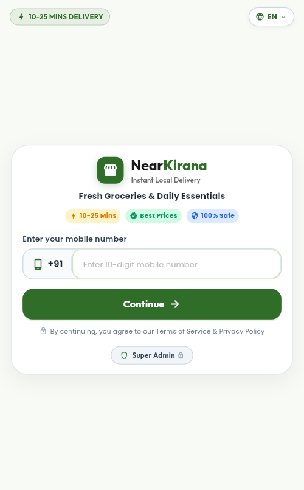
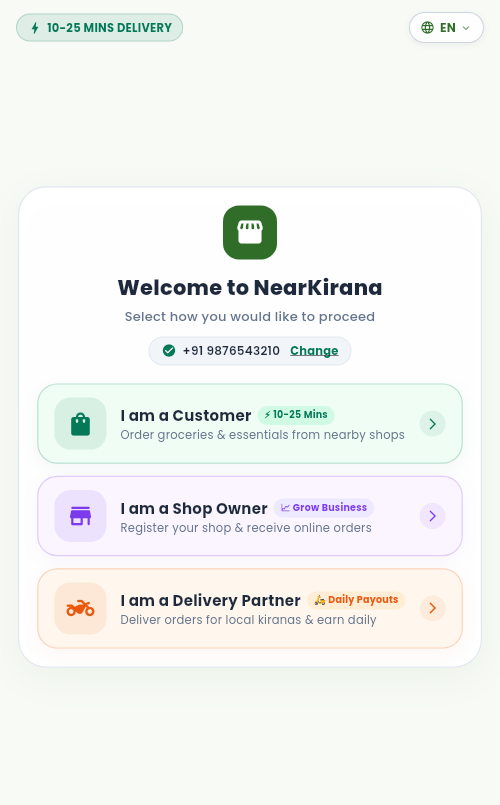
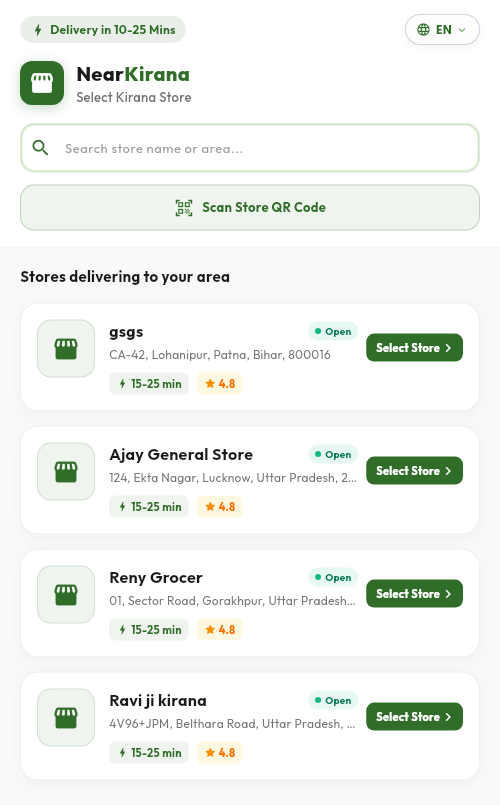
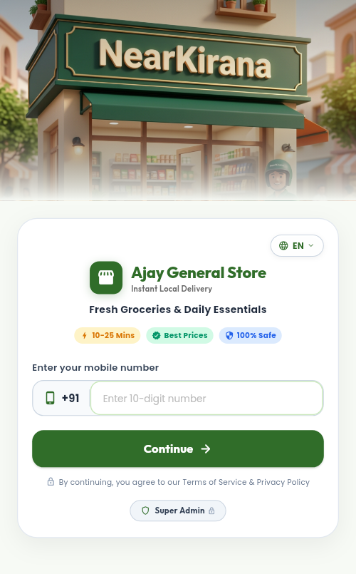
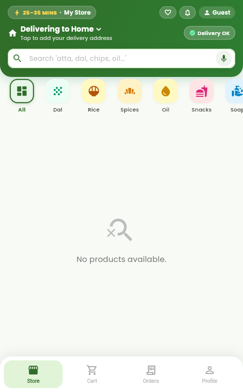
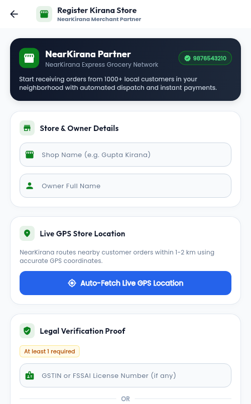
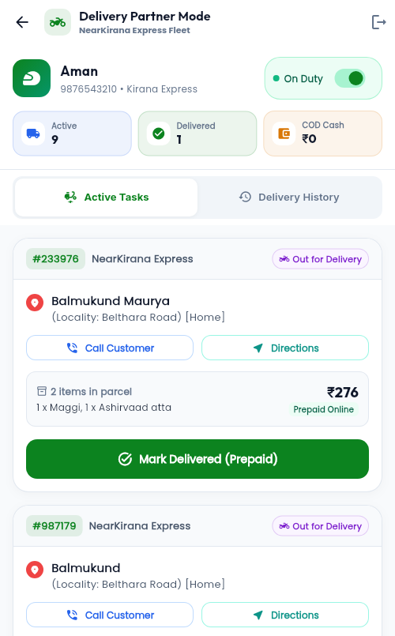
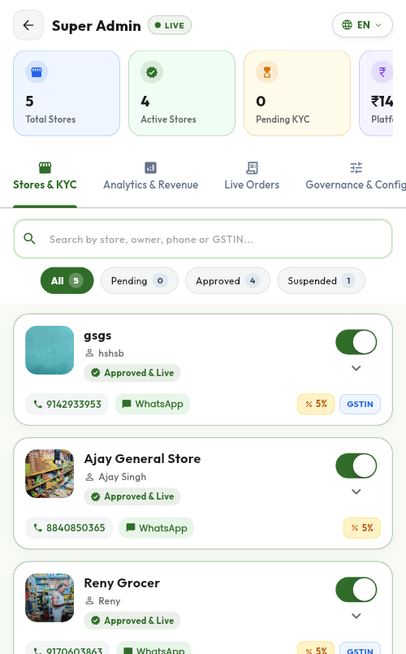

# NearKirana - Hyperlocal Kirana Delivery and Store ERP Platform

NearKirana is an enterprise-grade, multi-tenant Flutter application engineered to digitize traditional Indian neighborhood grocery stores (Kirana shops). The platform bridges local store owners, neighborhood customers, delivery agents, and platform administrators into a unified commerce ecosystem.

---

## Application Screenshots

All screenshots below are captured directly from the live NearKirana application interface and database:

### 1. Customer Onboarding and Store Discovery

| Authentication Gateway | Multi-Role Portal Selection |
| :---: | :---: |
|  |  |
| **Authentication Gateway**: Mobile authentication with country code, 10-25 mins instant delivery promise, language switch (English, Hindi, Hinglish), and discreet Super Admin entry. | **Unified Role Selection**: Dynamic interface allowing verified users to proceed as Customer (Grahak), Kirana Store Owner (Dukandar), or Delivery Partner. |

| Hyperlocal Store Discovery | Branded Storefront Landing |
| :---: | :---: |
|  |  |
| **Store Selector**: GPS-driven discovery of nearby open stores (with distance, ratings, delivery time), area search bar, and store QR code scanning. | **Storefront Branding**: Individual store landing page with custom branding, store operating status, and product catalog entry. |

---

### 2. Shopping Experience and Merchant Operations

| Customer Shopping Catalog | Merchant Store Onboarding |
| :---: | :---: |
|  |  |
| **Customer Shopping Experience**: Address delivery bar, instant category filters (All, Dal, Rice, Spices, Oil, Snacks, Soap), bilingual voice search mic, and bottom navigation. | **Merchant Store Registration**: Zepto/Blinkit inspired onboarding with live GPS boundary auto-fetch, legal verification proof (GSTIN/FSSAI), and automated dispatch setup. |

| Delivery Fleet Operations | Super Admin Governance |
| :---: | :---: |
|  |  |
| **Delivery Partner Fleet**: Real-time duty toggle, live delivery counts, active order cards with items breakdown, customer calling, and Google Maps routing. | **Platform Super Admin**: Platform-wide store oversight, active store toggles, KYC verification, commission tracking, and dispute management. |

---

## System Overview and Core Concept

In traditional local retail, neighborhood kirana stores face three primary challenges:
1. Loss of grocery market share to centralized dark-store quick-commerce operators.
2. Manual bookkeeping errors and delayed recovery of customer credit (Udhar/Khata).
3. Inability to manage and track home deliveries with verified proof of handover.

NearKirana addresses these problems by empowering existing kirana stores with a digital-first mobile architecture:
- **For Neighborhood Customers**: Quick ordering from their trusted neighborhood kirana, live delivery tracking, bilingual voice-based ordering, and digital settlement options.
- **For Kirana Merchants (Store Owners)**: A full-fledged digital Point-of-Sale (POS) and Enterprise Resource Planning (ERP) platform featuring live order dispatch, barcode inventory management, batch and expiry date tracking, and a digital Khata ledger with automated WhatsApp payment reminders.
- **For Delivery Partners**: Dedicated dispatch dashboard, pickup verification, turn-by-turn road navigation, customer contact integration, and 4-digit PIN verification upon package handover.
- **For Super Administrators**: Platform-wide governance, store onboarding verification, KYC compliance, and multi-tenant catalog management.

---

## How the Application Works

### 1. Customer Shopping Workflow

1. **Authentication and Profile Initialization**:
   - The user opens the app and enters their 10-digit mobile number.
   - Upon verification via Firebase Authentication, the profile is synchronized with Firestore.
   - Language preferences (English, Hindi, or Hinglish) can be selected at any point using the top-bar selector.

2. **Hyperlocal Shop Discovery**:
   - The app uses GPS geofencing via `Geolocator` to find registered kirana stores within the configurable delivery radius (typically 1 to 5 km).
   - Customers can also browse stores by entering their area or pincode, or by scanning the merchant's physical Store QR Code.

3. **Product Catalog and Search**:
   - Products are categorized into Atta & Flours, Rice & Dals, Dairy & Eggs, Spices, and Packaged Snacks.
   - Cloud Firestore substring indexing (`searchKeywords`) powers fast, instant keyword search suggestions.
   - Each item displays real-time stock levels, MRP, discounted price, and unit measures (kg, g, litre, piece).

4. **Cart and Dynamic Tiered Pricing**:
   - Handled reactively using `CartProvider` and `CartCalculator`.
   - Validates store-specific minimum order thresholds.
   - Calculates dynamic delivery fees based on order amount (for example, free delivery on orders above Rs. 499).
   - Allows applying promotional coupon codes and redeeming loyalty points for direct bill discounts.

5. **Address Selection and Checkout**:
   - Customers can save multiple delivery addresses with landmark and house number, complete with GPS map pin positioning (`flutter_map`).
   - Payment options include Cash on Delivery (COD), UPI deep-linking, and online payments through Razorpay.

6. **Live GPS Delivery Tracking and PIN Verification**:
   - Dispatched orders feature live road navigation using Open Source Routing Machine (OSRM) polylines.
   - Customers view real-time driver movement, dynamic ETA, and a confidential 4-digit Delivery PIN.
   - The delivery partner must input this 4-digit PIN at the customer's doorstep to successfully finalize delivery.

7. **Voice Ordering (Bilingual NLP)**:
   - Speech-to-text integration (`voice_order_parser.dart` and `voice_order_service.dart`).
   - Customers can speak their order in Hindi or English (such as "Do packet doodh aur ek kilo cheeni").
   - A linguistic entity parser extracts quantities, units, and item names, mapping them directly into the cart.

---

### 2. Merchant and Store Owner (Admin) Workflow

1. **Store Onboarding and Geofencing**:
   - Store owners register their shop by specifying name, contact numbers, exact GPS coordinates, delivery radius, operating hours, and minimum order rules.
   - The app generates a customized printable UPI QR code for in-store payments.

2. **Order Lifecycle State Machine**:
   - Incoming customer orders pass through strict transactional phases:
     - `Pending` -> `Accepted` -> `Packing` -> `Out for Delivery` -> `Delivered` (or `Cancelled`).
   - If an ordered item is out of stock, the merchant can suggest alternative product substitutions directly in the order card.

3. **Inventory, Barcode Scanning, and Expiry Management**:
   - Camera-based barcode scanner (`simple_barcode_scanner`) allows instant product lookup and rapid stock replenishment.
   - Batch numbers and expiry dates (`batch_service.dart`) enable automatic alerts for approaching expirations, minimizing stock spoilage.
   - Automated low-stock triggers notify merchants when inventory drops below safety thresholds.

4. **Digital Khata (Customer Credit Ledger)**:
   - Eliminates traditional manual paper ledgers.
   - Records credit given (Udhar) and payments received (Jama) per customer.
   - Generates instant PDF account statements.
   - Single-tap WhatsApp reminder triggers WhatsApp with a pre-filled transaction summary, total dues, and payment link.

5. **Supplier Procurement and Expense Bookkeeping**:
   - Complete directory of FMCG distributors and suppliers.
   - Records purchase invoices, payment histories, and upcoming vendor payables.

6. **Business Analytics and Tax Invoicing**:
   - Real-time sales charts, revenue metrics, and high-demand product tracking via `fl_chart`.
   - Generates formatted PDF tax invoices with shop branding and thermal printer support (`pdf` and `printing` packages).

---

### 3. Delivery Partner Workflow

1. **Duty Management**:
   - Delivery personnel toggle duty status between On Duty and Off Duty.
2. **Order Pickup**:
   - Dispatched parcels are assigned to the driver, displaying total item breakdown and customer address.
3. **Navigation and Contact**:
   - Direct one-tap customer calling and Google Maps turn-by-turn routing to the customer doorstep.
4. **Secure PIN Handover**:
   - Handover requires the customer to share their secret 4-digit PIN, eliminating fraudulent or misplaced deliveries.

---

### 4. Super Admin Governance

1. Master oversight of all onboarding applications, store verification, and status activation.
2. Commission structure configuration and platform-wide revenue analytics.
3. Master product catalog management to accelerate onboarding of new kirana stores.

---

## Technical Architecture

### Technology Stack

- **Frontend**: Flutter 3.x / Dart 3.x
- **Architecture**: Multi-tenant Provider pattern (`ChangeNotifierProvider`, `MultiProvider`)
- **Backend Database**: Google Cloud Firestore (Real-time NoSQL document synchronization)
- **Authentication**: Firebase Authentication, Phone/Email verification via InAppWebView
- **Mapping and Routing**: `flutter_map`, `latlong2`, Open Source Routing Machine (OSRM)
- **Geolocation**: `geolocator`, `geocoding`
- **Charts and Analytics**: `fl_chart`
- **Payment Gateway**: Razorpay Flutter SDK, UPI Intent deep-linking
- **Hardware Integration**: Camera barcode scanner, Vibration engine, Local audio alerts
- **Document Generation**: PDF invoice creation and thermal printing via `pdf` and `printing`
- **Voice Recognition**: `speech_to_text` with custom regex and linguistic entity extraction

---

### Firestore Database Schema

- `shops`: Store configuration, business hours, GPS coordinates, delivery radius, fee structure, UPI QR.
- `products`: Catalog entries indexed by `shopId`, categories, MRP, sale price, stock count, batch info, search keywords.
- `orders`: Transactional records containing line items, pricing tiers, delivery address, live status, and 4-digit delivery PIN.
- `users`: User profiles, role assignments (Customer, Admin, ShopBoy, SuperAdmin), saved addresses, and loyalty points.
- `khata`: Customer credit/debit ledger entries with timestamps, transaction type, and payment proof.
- `suppliers`: Vendor database, procurement invoices, and payables.
- `coupons`: Promotional discount codes, minimum order value requirements, and validity windows.
- `complaints`: Customer feedback, dispute records, and refund statuses.

---

## Project Directory Structure

```text
NearKirana/
├── android/                 # Android platform build configs
├── ios/                     # iOS platform build configs
├── web/                     # Web platform deployment assets
├── assets/
│   ├── images/              # Branding and vector assets
│   ├── lottie/              # Animated Lottie illustrations
│   └── sounds/              # Order alert notifications
├── docs/
│   └── screenshots/         # Application documentation screenshots
├── lib/
│   ├── l10n/                # Localization ARB files (English, Hindi, etc.)
│   ├── widgets/             # Reusable UI widgets and custom components
│   ├── admin_dashboard.dart # Merchant ERP control center
│   ├── admin_orders_tab.dart# Order processing pipeline
│   ├── atomic_order_service.dart # ACID-compliant Firestore order service
│   ├── cart_provider.dart   # Shopping cart state management
│   ├── cart_screen.dart     # Mobile and desktop checkout interface
│   ├── custom_auth_screen.dart # User verification flow
│   ├── customer_live_tracking_screen.dart # Real-time GPS delivery tracking
│   ├── customer_shop_tab.dart # Customer storefront and catalog browser
│   ├── khata_screen.dart    # Digital ledger bookkeeping
│   ├── main.dart            # Application entry point and router
│   ├── order_state_machine.dart # Order status progression engine
│   ├── road_routing_service.dart# Road polyline and ETA calculations
│   ├── shop_provider.dart   # Multi-shop selector and geofencing
│   ├── voice_order_parser.dart # Bilingual voice order parsing logic
│   └── ...
└── pubspec.yaml             # Dart dependencies and asset registrations
```

---

## Getting Started

### Prerequisites

- Flutter SDK (version 3.12.2 or higher)
- Dart SDK (version 3.x)
- Android Studio or Xcode for mobile emulation
- Firebase Project configured with Firestore, Authentication, and Storage

### Installation

1. Clone the repository:
   ```bash
   git clone https://github.com/Balmukund-Maurya/NearKirana_Kirana_StoreBuilder.git
   ```

2. Change to the project directory:
   ```bash
   cd NearKirana_Kirana_StoreBuilder
   ```

3. Install project dependencies:
   ```bash
   flutter pub get
   ```

4. Generate localization files:
   ```bash
   flutter gen-l10n
   ```

5. Verify Flutter configuration and connected devices:
   ```bash
   flutter doctor
   flutter devices
   ```

6. Run the application:
   ```bash
   flutter run
   ```

---

## Security and Production Guidelines

- **Tenant Isolation**: Firestore security rules enforce strict tenant boundary isolation ensuring merchants can only access records matching their verified `shopId`.
- **Delivery Verification**: The 4-digit PIN verification is executed atomically inside `atomic_order_service.dart` to prevent race conditions during order completion.
- **Environment Variables**: Sensitive API credentials (including Razorpay Key ID and Secret) should be supplied via compile-time environment flags (`--dart-define`) rather than stored directly in source code.

---

## License

This project is proprietary and developed for local kirana store digitization and hyperlocal grocery delivery networks.
